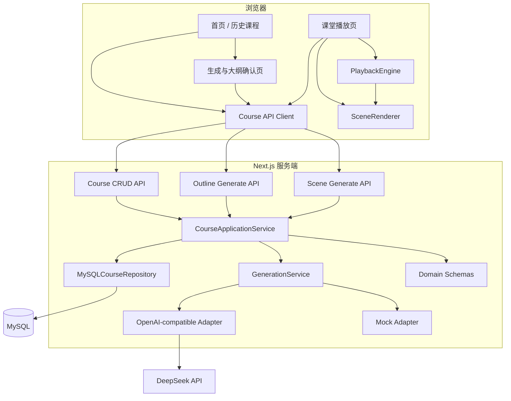
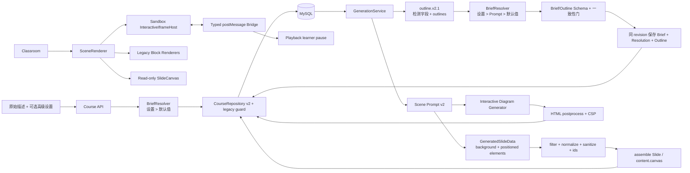
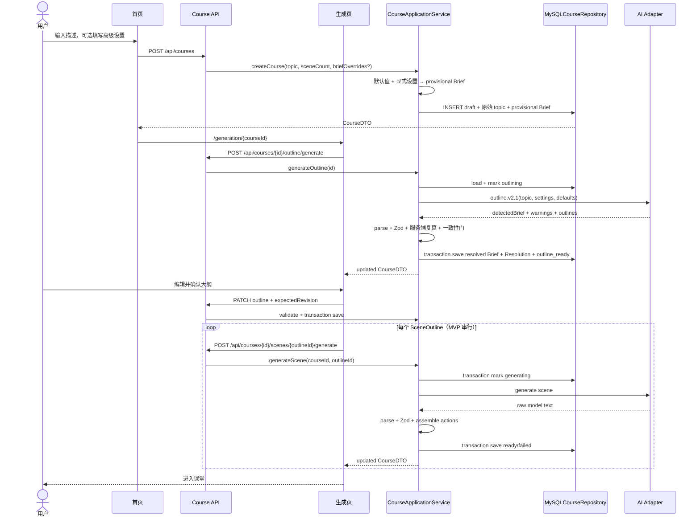
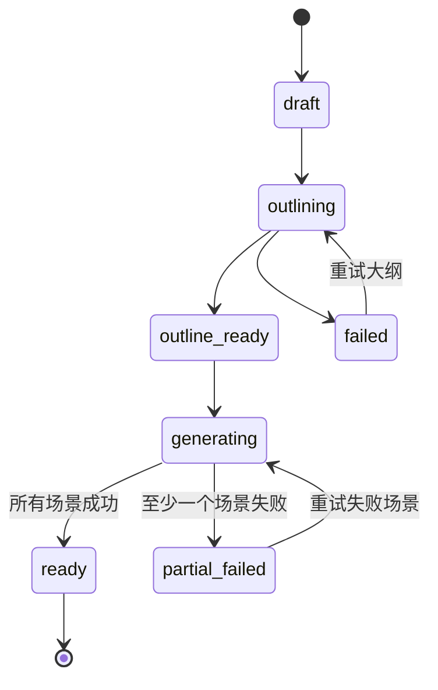

# 03. 系统架构设计

> 文档版本：0.4
> 前置文档：[01-scope.md](01-scope.md)、[02-requirements.md](02-requirements.md)  
> 状态说明：M1～M7.1 已进入正式调用链；M7.0 的 DeepSeek v0.3 基线保持冻结，M7.1 已实现 CourseBrief、Course schema v2 与 outline.v2.1。Slide/PPTElement、interactive 和再生成仍分别属于 M8～M10。

## 1. 架构结论

MVP 采用一个 Next.js App Router 单体：

- React Client Components 负责交互、进度展示、课堂渲染和播放；
- Next.js Route Handlers 与应用服务负责课程用例、模型调用和事务边界；
- MySQL 通过服务端 CourseRepository 保存课程，是唯一课程事实来源；
- 共享的 TypeScript + Zod 领域契约连接客户端、接口和持久化；
- 客户端以 courseId 为恢复锚点，串行触发“大纲 → 场景”，但不直接持久化课程；
- MVP 以 DeepSeek 作为唯一验收远端 Provider；百炼兼容档仍复用同一 OpenAI-compatible AIAdapter，但属于可选扩展；
- 大模型只生成 DTO，领域装配器负责 id、状态、Action 和时间戳；
- 第一版不拆微服务、不建 monorepo、不使用 LangGraph。

这套架构与 OpenMAIC 保持相同主方向，但把平台能力裁剪成一名学生可以理解、实现和验证的规模。v0.4 继续使用同一个 Next.js 单体、CourseRepository、AIAdapter 和播放器，只增加质量上下文、PPT 式只读幻灯片画布与一个沙箱互动场景，不引入 LangGraph 或新的服务进程。

## 2. OpenMAIC 深度解析结论

### 2.1 规模与分层

截至 2026-08-23 当前检出版本，参考仓库约有 1,960 个 TypeScript/JavaScript/CSS 源文件、600 个测试文件、43 个 API Route 和 6 个主要 `@openmaic/*` 包。这些数字说明它已是平台工程，不能把“完整功能一致”作为个人毕设第一阶段目标。

OpenMAIC 可以从高到低理解成三层：

1. **应用壳**：`app/` 和 `components/` 提供首页、生成预览、课堂、编辑器和 API；
2. **应用服务层**：`lib/` 负责 Provider、生成适配、播放、存储、媒体、对话和业务状态；
3. **可复用包**：`@openmaic/dsl`、`generation`、`renderer`、`editor`、`importer`、`storage` 提供纯契约或稳定能力。

阅读时应先理解 package 中的纯能力，再看 `lib/` 如何注入 Provider、浏览器状态和产品规则。只读 `lib/` 容易误以为所有能力都耦合在一个应用中。

### 2.2 领域主干

OpenMAIC 的稳定核心是：

```text
Stage
 ├─ SceneOutline[]  生成计划
 └─ Scene[]         可播放页面
      ├─ content    slide / quiz / interactive / pbl
      └─ actions[]  speech / whiteboard / discussion / widget / effects
```

`Scene` 使用判别联合约束 `scene.type` 与 `content.type` 一致。Action 又分为立即执行的视觉效果和必须等待完成的同步动作。这使内容生成、渲染和播放可以围绕同一份数据契约协作。

### 2.3 浏览器端课程生产链

真实主链不是“一次调用生成整门课程”，而是：

1. `app/page.tsx` 收集主题和材料，把生成会话写入 sessionStorage；
2. `generation-preview` 解析材料、可选搜索并创建 Stage；
3. 通过 SSE 流式生成 SceneOutline；
4. 用户可审核大纲；
5. 可选生成课程角色；
6. 首个场景先调用 scene-content，再调用 scene-actions；
7. 可选生成首场景 TTS；
8. 保存 Stage、Outline 和首场景，跳转课堂；
9. `classroom/[id]` 从存储加载数据，并继续生成剩余场景和媒体；
10. 每个场景完成后增量保存，失败场景单独记录和重试。

“先生成首场景再进入课堂”降低了首屏等待时间，但也引入了恢复、并发、媒体任务和完成屏障等复杂状态。毕设 MVP 仍串行生成全部 3～5 个场景，并只在全部成功时把课程标记为 `ready`；若中途失败但已有成功场景，生成页和课堂路由允许只读增量预览这些已持久化结果，不把部分预览伪装成正式完成。后续确有性能需求时再采用生成期间自动切换课堂。

### 2.4 服务端异步生成链

OpenMAIC 另有 `POST /api/generate-classroom`：接口创建 job，后台依次生成大纲、场景、媒体和 TTS，调用方轮询 `GET /api/generate-classroom/{jobId}`。这主要服务外部集成和长任务，不是浏览器 MVP 的必要条件。

本项目第一版仍不实现持久化服务端 job。浏览器串行触发每个短生命周期生成请求；服务端在请求内读取 MySQL 聚合、标记阶段、调用模型并事务保存结果。这样刷新后能从数据库恢复，又不必同时引入队列、Worker 和 job 轮询。只有生成任务需要脱离浏览器长期运行时，才升级为持久化 Job/Queue。

### 2.5 渲染与播放

OpenMAIC 的普通课件不是模型生成 React 代码。SceneRenderer 根据 `scene.type` 选择固定 React 渲染器；PlaybackEngine 顺序读取 `Scene.actions[]`，ActionEngine 执行具体动作。

播放器是显式状态机，负责：

- 当前场景和动作游标；
- idle、playing、paused、live 等模式；
- speech 的音频、浏览器 TTS 或阅读时间回退；
- fire-and-forget 与同步动作的推进差异；
- discussion 中断、恢复和课程完成。

本项目复刻这个“数据驱动固定渲染 + 显式播放状态机”的核心，不复刻复杂白板和讨论动作。

### 2.6 多智能体的实际边界

OpenMAIC 的课程生产主要是结构化生成函数，不依赖 LangGraph。LangGraph 位于课堂实时对话路径，每个服务端请求最多执行一次：

```text
START → director → agent_generate → END
```

多轮讨论由客户端连续请求形成，而不是服务端图无限循环。因此，第一版不引入 LangGraph 不会妨碍大纲、场景和课堂播放。它只有在多角色实时讨论成为明确研究对象后才有价值。

### 2.7 存储与恢复

OpenMAIC 默认使用浏览器存储：Document、Runtime、KV 和 Asset Store 分别保存课程文档、运行状态、轻量键值和媒体字节；配置后可切换 HTTP + PostgreSQL/S3。课堂加载还处理版本迁移、旧媒体引用转换、生成恢复和并发删除防护。

本项目第一版只保存一个较小的 Course 聚合根，不提前复刻多后端协议。仍需保留三条原则：

1. 写入前校验；
2. 每个生成阶段增量保存；
3. 使用 schemaVersion 支持将来迁移。

### 2.8 质量保障边界

OpenMAIC 包含 JSON 修复、Schema/normalizer、按场景重试、存储校验、Vitest、Playwright 和离线 eval。这些机制能够提高“结构合法、可渲染、可播放、可恢复”的概率，但不能证明模型内容事实正确或教学质量优秀。离线 LLM/VLM Judge 评估也不是每次请求的事实核验。

本项目文档和论文必须区分：

- **确定性保证**：Schema、状态转换、选项索引、动作可执行、保存恢复；
- **统计性质量**：内容完整性、教学连贯性、事实正确性和语言质量。

## 3. 架构决策

**AD-01～AD-08 已在 v0.3 实现。**

### AD-01：使用 Next.js 单体

前端页面和模型 Route Handler 放在同一仓库。这样可以共享 Schema、隐藏 Key，并减少跨服务部署和 CORS 问题。

### AD-02：服务端拥有 Course，客户端拥有交互编排

服务端创建 courseId，并通过 CourseRepository 负责所有状态转换和持久化。客户端只串行触发各阶段、展示进度和发送取消信号。每个生成接口仍只处理一个大纲或一个场景，不建立常驻后台 job。

### AD-03：领域层不依赖框架

`lib/domain` 只包含类型、Zod Schema、纯校验、装配器和状态转换，不依赖 React、Next.js、MySQL 驱动或模型 SDK。

### AD-04：模型 DTO 与持久化实体分离

模型只能返回教学内容字段；id、courseId、outlineId、order、status、createdAt、updatedAt 由系统生成。这样模型无法破坏实体身份或恢复状态。

### AD-05：动作由程序装配

MVP 模型返回 narration，服务端把它转换为 speech Action。quiz 场景由程序追加 learner pause。暂不让模型自由生成任意 Action，先保证播放器契约稳定。

### AD-06：MySQL 一张课程主表保存一个聚合根

MySQL 的 courses 表保存 Course 顶层字段以及 outlines、scenes、sceneProgress、生成元数据等 JSON 列，并使用 revision 做乐观并发控制。测验作答放入独立 quiz_attempts 表。MVP 数据量小，聚合事务更新比提前拆成大量表更容易保持不变量；以后需要复杂查询时再规范化。

M2 实现选择 `mysql2/promise` 作为底层驱动，使用服务端进程级连接池、参数化 SQL 和显式事务；版本化 SQL 文件由 `scripts/migrate.mjs` 执行。该选择属于基础设施实现细节，领域和页面仍只依赖 `CourseRepository`，以后替换驱动不改变 Course 契约。

M3/M4 已把该架构用于正式生成调用：大纲与每个场景分别在模型调用前登记 `activeOperation`，调用期间不持有连接，返回后再以 operation id 和 revision 提交。场景按 outline 串行生成，单项失败只更新对应 `SceneProgress`；运行时不再提供一次性 fixture 装配路由。

这里不要求复制 OpenMAIC 的 PostgreSQL 选型。目标系统需要的是事务、外键、唯一约束、JSON、索引和版本化迁移，MySQL 8.0+ 可以满足这些条件，而且使用熟悉的数据库能降低第一阶段风险。若后续研究强依赖 pgvector 等 PostgreSQL 特性，再单独评估迁移，不让尚未出现的需求决定 MVP。

### AD-07：mock 与 OpenAI-compatible Provider 使用同一契约

mock 和 DeepSeek 返回相同 DTO，并经过同一套 Zod/领域校验。代码中保留的百炼兼容档也复用这一边界，不为页面建立另一套调用逻辑；是否实测第二 Provider 不影响 MVP 完成。

### AD-08：静态代码块属于内容，不属于执行环境

slide 可以包含 code block，其中 HTML、JSX、TSX 只作为源码字符串保存，渲染器仅进行文本转义和语法高亮，不运行代码。标题、正文、提示块、讲解稿等普通字段仍拒绝 HTML 与外链。v0.4 的 interactive iframe 是独立 Scene 类型和独立安全边界，不能借“代码块”创建执行路径。

**AD-09 已在 M7.1 实现；AD-10～AD-13 仍是 M8～M10 增量决策。**

### AD-09：原始描述可追溯，CourseBrief 在 outline.v2 中一次定稿

CourseBrief 是系统最终采用的教学上下文，不等同于一张必填表单。原始 topic 按用户提交内容保存；受众、学习者水平、学习目标、先修知识、时长、教学风格、互动偏好和附加要求则记录为 Course 事实，并为每个字段保存 `explicit_setting`、`prompt` 或 `default` 来源。首页保持 topic 必填，其余设置折叠且可选。

创建草稿时不增加模型调用。服务端先用显式设置覆盖确定性默认值，保存 `provisional` Brief。`outline.v2.1` 调用同时输出原文检测字段、解析警告和大纲，但不重复回传 resolved Brief；服务端按 `explicit_setting > prompt > default` 独占计算最终值，模型不能改变高级设置或字段来源。最终 Brief、Resolution 和 Outline 在同一 expectedRevision 短事务中提交，之后场景生成和再生成只读取这份 `resolved` CourseBrief。

该设计让“用户在 Prompt 中已经说明要求”和“用户只写主题”共用一条链：前者只为未说明字段补默认值，后者全部使用可解释默认值；正常路径不会增加独立的 Prompt 解析调用。描述与高级设置冲突时设置优先并保存警告。用户在确认大纲前修改 Brief 会使旧大纲失效并要求重新生成；场景生成后直接修改整课 Brief 不属于 M7.1。

### AD-10：M8 裁剪 OpenMAIC 的 PPTElement 直接生成链路

M8 的产品形态只有一种：固定比例、一次展示一个场景的 PPT 式 slide，不再建设类 Markdown、纵向讲义或同课双视图。其持久化事实与 OpenMAIC 的 `Slide` 同构：固定 `viewportSize: 1000`、`viewportRatio: 0.5625`，并在 `content.canvas` 中保存带稳定 id、绝对坐标、尺寸和样式的 `text/shape/line/code` 有限 PPTElement。

模型按照裁剪后的 OpenMAIC `slide-content` Prompt 直接返回背景和带 `left/top/width/height` 的元素。服务端不重新排版，只负责 JSON/Schema 校验、过滤未支持元素、补齐默认值、净化 text 富文本、丢弃损坏元素并分配 id，再参考 OpenMAIC `scene-builder` 装配为 Slide。旧 `content.blocks` 继续由现有 Renderer 读取，但只用于历史兼容。这里的 canvas 是 Slide 的逻辑坐标容器，不是 HTML `<canvas>` 或另一套页面格式。

桌面课堂用只读 SlideCanvas 等比缩放 16:9 页面；`1280×720` 及更大桌面视口中主要内容无需幻灯片内部滚动即可查看。首版通过 2～3 个真实主题截图和人工检查调整 Prompt，不建设通用自动排版、碰撞求解或逐元素质量报告。移动端、平板和窄屏不进入 M8～M10 架构承诺。

参考链必须成套查看：生成侧的 [`slide-content/system.md`](https://github.com/THU-MAIC/OpenMAIC/blob/59adbef03b63488a7ff1ea983cf0fbba51609f9f/packages/%40openmaic/generation/templates/slide-content/system.md)、[`pipeline-types.ts`](https://github.com/THU-MAIC/OpenMAIC/blob/59adbef03b63488a7ff1ea983cf0fbba51609f9f/packages/%40openmaic/generation/src/pipeline-types.ts)、[`scene-generator.ts`](https://github.com/THU-MAIC/OpenMAIC/blob/59adbef03b63488a7ff1ea983cf0fbba51609f9f/packages/%40openmaic/generation/src/scene-generator.ts) 和 [`scene-builder.ts`](https://github.com/THU-MAIC/OpenMAIC/blob/59adbef03b63488a7ff1ea983cf0fbba51609f9f/packages/%40openmaic/generation/src/scene-builder.ts)，以及 DSL/渲染侧的 [`slides.ts`](https://github.com/THU-MAIC/OpenMAIC/blob/59adbef03b63488a7ff1ea983cf0fbba51609f9f/packages/%40openmaic/dsl/src/slides.ts)、[`normalize.ts`](https://github.com/THU-MAIC/OpenMAIC/blob/59adbef03b63488a7ff1ea983cf0fbba51609f9f/packages/%40openmaic/dsl/src/normalize.ts)、[`SlideCanvas.tsx`](https://github.com/THU-MAIC/OpenMAIC/blob/59adbef03b63488a7ff1ea983cf0fbba51609f9f/packages/%40openmaic/renderer/src/SlideCanvas.tsx) 与 [`SlideElement.tsx`](https://github.com/THU-MAIC/OpenMAIC/blob/59adbef03b63488a7ff1ea983cf0fbba51609f9f/packages/%40openmaic/renderer/src/SlideElement.tsx)。移植时保留 MIT 许可，裁掉媒体、复杂公式、动效、编辑器依赖，并为上游富文本渲染增加本项目的小型白名单净化。详细边界见 [09-v0.4 方案第 5 节](09-v0.4-quality-and-interaction-plan.md)。

### AD-11：互动脚本只能在无同源权限的 iframe 中执行

`InteractiveContent.html` 是不可信完整文档，只允许进入 `srcDoc` iframe。sandbox 仅包含 `allow-scripts`，明确排除同源权限、表单提交、弹窗、下载和顶层导航；宿主注入拒绝外部资源与连接的 CSP，并用 `event.source` + 小型 Zod 联合管理 ready/reset/completed/error。首版只做完整文档、大小和外部能力等必要检查，不建设通用 JavaScript 审计平台。

可参考 OpenMAIC 的 [`interactive.ts`](https://github.com/THU-MAIC/OpenMAIC/blob/59adbef03b63488a7ff1ea983cf0fbba51609f9f/packages/%40openmaic/dsl/src/interactive.ts)、[`interactive-renderer.tsx`](https://github.com/THU-MAIC/OpenMAIC/blob/59adbef03b63488a7ff1ea983cf0fbba51609f9f/components/scene-renderers/interactive-renderer.tsx) 和 [`InteractiveIframeHost.tsx`](https://github.com/THU-MAIC/OpenMAIC/blob/59adbef03b63488a7ff1ea983cf0fbba51609f9f/components/scene-renderers/InteractiveIframeHost.tsx) 的职责拆分，但不能照搬其 `allow-forms/allow-popups`；本项目 diagram 仍只允许 `allow-scripts`。

### AD-12：M7～M10 不引入 LangGraph、多智能体和多模态

CourseBrief、Prompt v2、Slide/PPTElement 和 diagram HTML 都是现有两阶段生成管线的普通类型分支。LangGraph 只在未来出现多角色、有状态、跨请求编排问题时评估；多模态只在材料/图片输入成为范围时评估。未出现这些需求前，引入框架只会增加状态、费用和测试矩阵。

### AD-13：在线质量门与离线教学评价分开

在线硬门只处理 Schema、不变量、元素可解析性、答案索引、HTML 隔离和运行协议等确定性判断；幻灯片是否清楚、教学适配度和事实正确性通过固定主题与人工量表离线评估。LLM-as-judge 不进入当前在线链路。

### AD-X01：可选编辑器和导出继续复用 `Slide/PPTElement`

M11 的编辑器可以把 M8 的只读 SlideCanvas 作为绘制层，在其上叠加命中区域、选择框、拖拽和缩放交互；编辑操作最终通过 CourseRepository 保存。M12 的 PPTX 导出器也读取相同 `Slide/PPTElement`；互动场景不嵌入 PPTX，只以自包含 HTML 放入 ZIP 的 `interactive/` 目录。两项扩展都不得反向要求 M8 预先实现编辑状态、导出字段或第二份页面数据。

## 4. 组件视图



### 4.1 v0.4 组件增量

v0.4 不替换上图，只增加下面的受控分支：



互动 HTML 的后处理与 CSP 属于该 Scene 的隔离边界，不是通用脚本平台；slide text 的白名单净化是另一条更小的边界，两者不能混用。

## 5. 分层与职责

| 层 | 计划位置 | 允许职责 | 禁止职责 |
|---|---|---|---|
| 页面层 | `app/**/page.tsx` | 路由参数、页面组合、加载/错误边界 | Prompt、SQL、直接模型调用 |
| UI 组件 | `components/` | 表单、列表、渲染器、播放器控件 | 读取 Key、模型解析 |
| 客户端应用层 | `lib/client/` 或 hooks | 串行请求、取消、进度、Course API Client | SQL、模型解析 |
| 服务端应用层 | `lib/application/` | 用例、事务边界、状态转换、仓储与生成协调 | React、直接拼 SQL |
| 领域层 | `lib/domain/` | 类型、Schema、不变量、装配、状态机 | React、fetch、MySQL、模型 SDK |
| 生成层 | `lib/generation/` | Prompt、解析、校验、重试和错误分类 | 浏览器组件状态 |
| 评价层（M7/M10） | `lib/quality/`、`eval/` | 固定主题、人工量表、生成元数据与离线汇总 | 在线主观判分、自动美学门、直接持久化 |
| 幻灯片层（M8） | `lib/slides/`、`components/slides/` | 最小 Slide/PPTElement 类型、normalize、文本净化、只读 SlideCanvas 和四类 Renderer | 模型调用、直接写 MySQL、执行任意 HTML |
| 互动运行时（M9） | `lib/interactive/`、`components/interactive/` | HTML 校验/CSP、iframe 宿主、消息协议和 fallback | 读取服务端 Key、访问主页面身份 |
| AI 基础设施 | `lib/ai/` | mock、DeepSeek 配置与模型调用；保留可选兼容档 | 课程持久化 |
| 数据基础设施 | `lib/db/` | MySQLCourseRepository、事务、迁移 | Prompt 和播放推进 |
| API 层 | `app/api/**/route.ts` | 请求校验、应用服务调用、HTTP 映射 | React 状态、直接 SQL |

依赖方向应指向领域层。领域层不能反向导入其他层。

## 6. 页面与接口

### 页面路由

| 路由 | 职责 |
|---|---|
| `/` | 创建课程，显示历史课程和状态；M7 保持 topic 必填，增加可选折叠高级设置 |
| `/generation/[courseId]` | 加载草稿、生成/编辑大纲、展示 Brief 字段来源和警告；确认前修改 Brief 时使旧大纲失效；M10 增加 ready 场景再生成 |
| `/classroom/[courseId]` | 至少一个 ready 场景时加载成功场景并提示部分预览；M8 增加 OpenMAIC 式只读 SlideCanvas，M9 增加互动 iframe 宿主 |

courseId 必须进入 URL。刷新后页面通过 URL + Course API 从 MySQL 恢复，不能把 React state、sessionStorage 或 localStorage 作为课程事实来源。

### API 路由

| 接口 | 单次职责 | 是否保存课程 |
|---|---|---|
| `POST /api/courses` | 创建并保存 draft | 是 |
| `GET /api/courses` | 返回历史课程摘要 | 读 |
| `GET /api/courses/{courseId}` | 返回完整 CourseDTO | 读 |
| `DELETE /api/courses/{courseId}` | 删除课程及关联作答 | 是 |
| `POST /api/courses/{courseId}/outline/generate` | 生成、校验并保存大纲 | 是 |
| `PATCH /api/courses/{courseId}/brief`（M7） | 在大纲确认前保存显式设置，并使已有大纲失效 | 是 |
| `PATCH /api/courses/{courseId}/outline` | 保存用户编辑或确认的大纲 | 是 |
| `POST /api/courses/{courseId}/scenes/{outlineId}/generate` | 生成、校验并保存一个场景 | 是 |
| `POST /api/courses/{courseId}/scenes/{outlineId}/regenerate`（M10） | 按用户意见生成候选并原位替换 ready 场景 | 是 |

Route Handler 不直接拼 SQL，而是调用应用服务。应用服务加载聚合、执行状态转换、调用 GenerationService，并用 expectedRevision 事务保存；客户端收到成功响应时，对应结果已经进入 MySQL。

## 7. 课程创建时序



## 8. 状态与恢复

Course 状态转换：



恢复规则：

1. `draft`：显示主题并允许开始；
2. `outlining`：刷新后先重新读取数据库；超过请求超时上限仍未更新时，允许恢复为可重试失败；
3. `outline_ready`：恢复大纲编辑；
4. `generating`：保留 ready 场景；只把超过生成租约的遗留 generating 重置为可重试状态；
5. `partial_failed`：显示失败项和单项重试；已有 ready 场景时允许带缺失提示的部分课堂预览；
6. `ready`：全部场景完成，允许进入正式课堂。

浏览器刷新会中止客户端 fetch，但服务端请求可能已经提交结果。恢复时必须先读 MySQL，并用 operationId/revision 拒绝迟到响应；不能一刷新就覆盖仍在运行或刚完成的服务端操作。

## 9. 播放架构

PlaybackEngine 是纯状态机，输入为当前 Course.scenes，输出为模式、游标和回调事件：

```text
idle ── start ──> playing ── pause ──> paused
  ^                   |                  |
  |                   └──── resume ─────┘
  |
completed <── 所有场景与动作完成

playing ── learner pause ──> awaitingLearner ── submit/next ──> playing
idle/playing/paused ── quiz 全部提交 ──> completed
```

它不负责 React 渲染，也不直接访问 MySQL。页面订阅状态，SceneRenderer 渲染内容；TextOnlySpeechAdapter 默认显示文本并按估算时长完成，BrowserSpeechAdapter 可选包装 Web Speech API。切页、暂停和卸载都必须取消当前适配器及计时器。

## 10. 错误、取消与一致性

- Route Handler 把内部错误映射为统一 ApiError；
- 客户端只根据 `code/retryable` 决定提示和按钮，不能解析错误字符串；
- 每个生成请求关联 requestId 和 AbortSignal；
- 用户切换课程或离开生成页时 abort 当前请求；
- 保存采用“读取聚合 → 纯函数生成新聚合 → expectedRevision 事务更新”的写法；
- 模型成功但 MySQL 事务失败时，API 必须返回存储错误，UI 不能显示为持久化成功；
- revision 冲突返回 `COURSE_CONFLICT`，客户端重新加载，不能覆盖较新记录；
- 读取失败或 Schema 不合法时进入可诊断错误页，不把坏记录喂给渲染器；
- 删除与生成并发在 MVP UI 中互斥：生成中删除需先取消请求。

## 11. 安全边界

```text
浏览器：topic、CourseDTO、播放状态、轻量 UI 偏好
                │ 仅业务请求
                ▼
Route Handler / 应用服务：状态转换、Prompt、输出校验、事务
          │                              │
          ▼                              ▼
       MySQL                         DeepSeek
```

关键规则：

- 只有不含 `NEXT_PUBLIC_` 前缀的服务端环境变量保存模型 Key 和数据库凭据；
- `lib/ai/server-*.ts` 只能被 Route Handler 或服务端模块导入；
- 模型输出一律视为不可信；
- v0.3 不支持模型生成可执行 HTML；`code.code` 可保存只读 HTML/JSX/TSX 源码并由 React 转义，v0.4 只有 InteractiveRenderer 可以创建 script 执行路径；
- code block 始终按文本转义，不允许 `eval`、动态 import 或 `dangerouslySetInnerHTML`；
- interactive HTML 只能进入无 `allow-same-origin` 的 sandbox iframe，并由 CSP 禁止外部连接、子 frame、对象和表单提交；
- postMessage 只接受绑定 iframe 的 `event.source` 和严格消息联合，切页后拒绝旧 iframe 事件；
- API 限制 topic、outline 和响应长度，防止无界输入；
- 日志只记录 requestId、阶段、模型、耗时、尝试次数和校验结果。

## 12. 部署视图

MVP 需要一个 Next.js 进程、一个 MySQL 实例和现代浏览器：

```text
Browser
  ├─ React UI
  └─ 可选 Web Speech API
        │ HTTP(S)
Next.js Server
  ├─ MySQL
  └─ DeepSeek API
```

本地开发先启动 MySQL 并执行迁移，再运行 `pnpm dev`。第一版没有登录，虽然课程在服务端数据库中，也只允许部署到本机或受信任网络；“使用数据库”不自动等于“可以公开成为多用户服务”。备份采用数据库导出或受控 volume，不依赖浏览器缓存。

## 13. 已选 v0.4 扩展与更远期边界

M7～M10 已选择 CourseBrief/outline v2、PPT 式只读幻灯片、diagram 互动和单场景再生成，按接口扩展而不重写主链。M11 的 PPT 式幻灯片编辑器与 M12 的简化资源包导出是两个独立可选产品里程碑，不阻塞 v0.4 或 MX。以下能力仍属于 MX 或更远期候选：

- 文档输入：在 outline 请求前增加 DocumentExtractor；
- 生成优化：替换 GenerationPolicy，不改变已持久化身份和恢复语义；
- 新互动类型：只有 diagram 通过 M9 退出门后才扩展 Scene 判别联合和专用 Renderer/运行契约；
- 新动作：扩展 Action 联合和 ActionExecutor；
- 多智能体：在 discussion Action 后增加独立 ChatOrchestrator；
- 多用户：增加认证、ownerId、授权检查和租户级查询；
- 数据库演进：复杂查询出现后，把 Course JSON 列逐步规范化；
- 异步任务：把客户端循环迁移到持久化 Job/Queue；
- 多模态与 RAG：仅在材料输入或来源增强成为明确研究问题时加入。

任何扩展都必须保持旧 schemaVersion 的读取策略，并单独定义验收与实验指标。M7～M12 的完整依赖、顺序和止损规则见 [09-v0.4-quality-and-interaction-plan.md](09-v0.4-quality-and-interaction-plan.md)。
