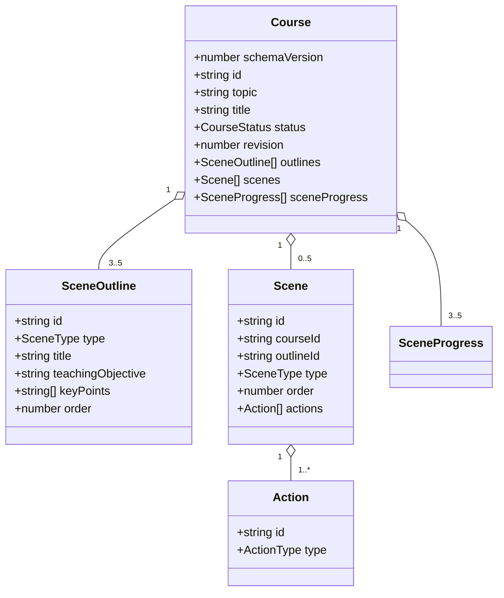

# 04. 领域模型与数据契约

> 文档版本：0.2  
> 目标：为页面、API、生成管线、播放器和 MySQL Repository 提供唯一数据语言。  
> 本文代码是设计契约，实施时以 `lib/domain` 中的 TypeScript + Zod 为可执行来源。

## 1. 建模原则

1. **模型输出不是领域实体**：大模型返回 DTO，系统装配 id、状态、顺序和时间戳；
2. **判别联合保证渲染安全**：`scene.type` 必须与 `content.type` 一致；
3. **生成状态显式持久化**：刷新后不靠内存猜测哪一步完成；
4. **Action 是唯一播放指令**：播放器不从页面文本隐式推导行为；
5. **一处定义，多处复用**：API、客户端和存储导入同一套 Zod Schema；
6. **先小后扩**：MVP 只定义真正有执行器和渲染器的类型。

## 2. 聚合关系



Course 是聚合根。外部代码不能单独持久化 Scene 或 SceneOutline，必须通过 CourseRepository 保存满足整体不变量的新 Course。

## 3. 基础类型

```ts
export const CURRENT_SCHEMA_VERSION = 1 as const;

export type CourseStatus =
  | 'draft'
  | 'outlining'
  | 'outline_ready'
  | 'generating'
  | 'partial_failed'
  | 'ready'
  | 'failed';

export type SceneType = 'slide' | 'quiz';

export type SceneGenerationStatus =
  | 'pending'
  | 'generating'
  | 'ready'
  | 'failed';

export type ProviderId = 'mock' | 'deepseek' | 'bailian';

export interface GenerationMetadata {
  provider: ProviderId;
  model: string;
  promptVersion: string;
  requestId: string;
  durationMs: number;
  upstreamCalls: number;
  repaired: boolean;
  usage?: { inputTokens?: number; outputTokens?: number };
  generatedAt: number;
}

export interface GenerationOperation {
  id: string;
  stage: 'outline' | 'scene';
  outlineId?: string;
  startedAt: number;
  expiresAt: number;
}

export interface DomainError {
  code: string;
  message: string;
  retryable: boolean;
  stage?: 'outline' | 'scene' | 'storage' | 'playback';
  details?: Record<string, unknown>;
}
```

Course、Outline、Scene、Action、Question 和 Option 的系统 ID 统一由应用使用 `crypto.randomUUID()` 创建。文档示例中的可读 ID 仅为方便说明，不是另一套生产格式；模型永远不能提供或覆盖实体 ID。

`DomainError.details` 只保存可序列化、无敏感信息的诊断字段。不得放入 Error 对象、API Key、完整 Prompt 或原始模型响应。

## 4. Course 聚合根

```ts
export interface Course {
  schemaVersion: typeof CURRENT_SCHEMA_VERSION;
  id: string;
  topic: string;
  title: string;
  requestedSceneCount: number;
  status: CourseStatus;
  revision: number;
  outlines: SceneOutline[];
  scenes: Scene[];
  sceneProgress: SceneProgress[];
  outlineGeneration?: GenerationMetadata;
  activeOperation?: GenerationOperation;
  lastError?: DomainError;
  createdAt: number;
  updatedAt: number;
}

export interface SceneProgress {
  outlineId: string;
  status: SceneGenerationStatus;
  attempts: number;
  lastError?: DomainError;
  updatedAt: number;
}
```

### Course 不变量

- `schemaVersion === 1`；
- `id` 非空且创建后不可修改；
- `topic.trim().length` 为 2～500；
- `requestedSceneCount` 为 3～5 的整数；
- revision 为从 0 开始的非负整数，只能由 Repository 在成功提交时递增；
- outline_ready 及之后状态必须有与 requestedSceneCount 相同数量的大纲；
- outlines 的 id 唯一，order 为从 1 开始的连续整数；
- scenes 的 id 和 outlineId 唯一；
- 每个 Scene.outlineId 必须引用当前 Course 的大纲；
- Scene.courseId 必须等于 Course.id；
- Scene.type、Scene.content.type 和对应 Outline.type 三者一致；
- sceneProgress 必须与 outlines 一一对应；
- ready 状态要求所有 progress 与 scenes 均 ready；
- partial_failed 要求至少一个 failed，且至少一个场景没有完成；
- activeOperation 存在时必须与当前 outlining 或 generating 状态一致；迟到结果只有 operation id 和 expectedRevision 同时匹配才允许提交；
- `updatedAt >= createdAt`。

状态字段不是装饰信息。页面恢复、允许操作和验收逻辑都只能依赖这些显式状态。

## 5. SceneOutline

```ts
export interface SceneOutline {
  id: string;
  type: SceneType;
  title: string;
  teachingObjective: string;
  keyPoints: string[];
  order: number;
  estimatedMinutes?: number;
}
```

约束：

- title 为 1～80 个字符；
- teachingObjective 为 1～300 个字符；
- keyPoints 为 2～5 项，每项 1～160 个字符；
- order 由服务端标准化，不接受重复；
- 至少一个 quiz，且 quiz 不应作为第一场景；
- MVP 最多两个 quiz，避免课程被测验占满；
- estimatedMinutes 可选，若存在则为 1～20。

“至少一个 quiz”属于课程级语义规则，不能只靠单个 SceneOutline Schema 判断，应由 `validateCourseOutline` 检查。

## 6. Scene 判别联合

```ts
interface SceneBase {
  id: string;
  courseId: string;
  outlineId: string;
  title: string;
  summary: string;
  order: number;
  actions: Action[];
  generation: GenerationMetadata;
  createdAt: number;
  updatedAt: number;
}

export type Scene = SlideScene | QuizScene;

export interface SlideScene extends SceneBase {
  type: 'slide';
  content: SlideContent;
}

export interface QuizScene extends SceneBase {
  type: 'quiz';
  content: QuizContent;
}
```

summary 是供下一场景生成使用的短摘要，限制为 1～300 个字符。narration 不重复存成字段，而是在装配时转换为 speech Action，避免出现两份讲解文本相互漂移。

不使用下面这种宽松结构：

```ts
// 禁止：type 和 content 可以互相矛盾
interface BadScene {
  type: 'slide' | 'quiz';
  content: SlideContent | QuizContent;
}
```

## 7. Slide 内容

MVP 幻灯片不是自由坐标画布，而是固定布局的内容块。这样更容易校验、响应式渲染和生成稳定。

```ts
export interface SlideContent {
  type: 'slide';
  subtitle?: string;
  blocks: SlideBlock[];
}

export type SlideBlock =
  | ParagraphBlock
  | BulletListBlock
  | CalloutBlock
  | CodeBlock;

export interface ParagraphBlock {
  id: string;
  type: 'paragraph';
  text: string;
}

export interface BulletListBlock {
  id: string;
  type: 'bullet_list';
  items: string[];
}

export interface CalloutBlock {
  id: string;
  type: 'callout';
  tone: 'info' | 'example' | 'warning';
  title?: string;
  text: string;
}

export interface CodeBlock {
  id: string;
  type: 'code';
  language: string;
  code: string;
  caption?: string;
}
```

约束：

- 每页 1～5 个 blocks；
- paragraph.text 为 1～500 个字符；
- bullet_list 为 2～6 项，每项 1～180 个字符；
- callout.text 为 1～400 个字符；
- code.language 为 1～32 个安全标识字符，code 为 1～6,000 个字符，caption 最多 120 个字符；
- CodeBlockRenderer 必须把 code 当纯文本转义；语法高亮不能使用 `dangerouslySetInnerHTML` 注入模型原文；
- block id 唯一并由装配器生成；
- 所有页面可见文本总量设置上限，避免模型返回不可阅读的“文字墙”。

自由坐标、图片、图表、公式和动画均不进入 MVP。需要这些能力时新增明确 Block 类型，而不是向现有字段塞入任意 HTML。

## 8. Quiz 内容

```ts
export interface QuizContent {
  type: 'quiz';
  questions: SingleChoiceQuestion[];
}

export interface SingleChoiceQuestion {
  id: string;
  type: 'single_choice';
  prompt: string;
  options: QuizOption[];
  correctOptionId: string;
  explanation: string;
}

export interface QuizOption {
  id: string;
  label: string;
}
```

约束：

- 每个 quiz 场景包含 1～3 题；
- prompt 为 1～300 个字符；
- 每题 2～4 个选项；
- option.id 在题内唯一；
- correctOptionId 必须引用现有选项；
- explanation 为 1～500 个字符；
- 判分完全由本地代码完成；
- 用户作答状态不写回 Course 文档，单独使用 `QuizAttempt` 记录，避免修改生成内容。

```ts
export interface QuizAttempt {
  courseId: string;
  sceneId: string;
  questionId: string;
  selectedOptionId: string;
  correct: boolean;
  submittedAt: number;
}
```

QuizAttempt 保存到 MySQL 独立 quiz_attempts 表；删除 Course 时通过外键或同一事务级联删除。

## 9. Action

```ts
export type Action = SpeechAction | PauseAction;

export interface ActionBase {
  id: string;
}

export interface SpeechAction extends ActionBase {
  type: 'speech';
  text: string;
  rate?: number;
}

export interface PauseAction extends ActionBase {
  type: 'pause';
  reason: 'timed' | 'learner';
  durationMs?: number;
}
```

约束：

- 每个 Scene 至少有一个非空 speech；
- speech.text 为 1～1,500 个字符；
- rate 若存在则为 0.5～2；
- timed pause 必须有 0～30,000 的 durationMs；
- learner pause 不允许 durationMs；
- quiz 的最后一个 Action 必须是 learner pause；
- slide 不应包含 learner pause；
- Action id 在 Scene 内唯一。

MVP 的 Action 由系统装配：

```ts
function buildActions(type: SceneType, narration: string): Action[] {
  const actions: Action[] = [
    { id: createId(), type: 'speech', text: narration.trim() },
  ];

  if (type === 'quiz') {
    actions.push({
      id: createId(),
      type: 'pause',
      reason: 'learner',
    });
  }

  return actions;
}
```

模型不直接返回 Action id，也不能注入未知 action.type。

## 10. 模型 DTO 与领域实体分离

### 10.1 大纲模型输出

```ts
export interface OutlineModelOutput {
  courseTitle: string;
  outlines: Array<{
    type: SceneType;
    title: string;
    teachingObjective: string;
    keyPoints: string[];
    order: number;
    estimatedMinutes?: number;
  }>;
}
```

解析后由 `assembleCourseOutline`：

1. 规范化字符串；
2. 按 order 排序并重新编号；
3. 为每项生成 outline id；
4. 检查课程级不变量；
5. 返回可以交给客户端的 `CourseOutlineDTO`。

### 10.2 场景模型输出

```ts
export type SlideBlockModelOutput =
  | { type: 'paragraph'; text: string }
  | { type: 'bullet_list'; items: string[] }
  | { type: 'code'; language: string; code: string; caption?: string }
  | {
      type: 'callout';
      tone: 'info' | 'example' | 'warning';
      title?: string;
      text: string;
    };

export interface SlideContentModelOutput {
  subtitle?: string;
  blocks: SlideBlockModelOutput[];
}

export interface QuizContentModelOutput {
  questions: Array<{
    type: 'single_choice';
    prompt: string;
    options: Array<{ label: string }>;
    correctOptionIndex: number;
    explanation: string;
  }>;
}

export type SceneModelOutput =
  | {
      type: 'slide';
      title: string;
      content: SlideContentModelOutput;
      narration: string;
      summary: string;
    }
  | {
      type: 'quiz';
      title: string;
      content: QuizContentModelOutput;
      narration: string;
      summary: string;
    };
```

模型 DTO 在类型层面就没有 block/question/option id，也不能提供 correctOptionId。装配器检查 correctOptionIndex 后统一补齐实体 ID、content 判别字段、引用、summary、Action 和时间戳。

### 10.3 API DTO

```ts
export interface CourseOutlineDTO {
  courseTitle: string;
  outlines: SceneOutline[];
}

export interface CourseResponseDTO {
  course: Course;
}
```

大纲和场景模型 DTO 只在服务端生成层内部流动。面向浏览器的课程变更 API 返回已经事务提交的 CourseResponseDTO；Course 状态转换由服务端应用服务完成，客户端不能自行提交任意状态字符串。

## 11. 状态转换

所有 Course.status 修改必须经纯函数，禁止在组件中随意赋字符串。

```ts
type CourseEvent =
  | { type: 'OUTLINE_REQUESTED' }
  | { type: 'OUTLINE_SUCCEEDED'; outline: CourseOutlineDTO }
  | { type: 'OUTLINE_FAILED'; error: DomainError }
  | { type: 'OUTLINE_CONFIRMED' }
  | { type: 'SCENE_STARTED'; outlineId: string }
  | { type: 'SCENE_SUCCEEDED'; scene: Scene }
  | { type: 'SCENE_FAILED'; outlineId: string; error: DomainError }
  | { type: 'GENERATION_FINISHED' };

export function reduceCourse(course: Course, event: CourseEvent): Course;
```

关键规则：

- OUTLINE_REQUESTED：draft/failed → outlining；
- OUTLINE_SUCCEEDED：outlining → outline_ready；
- OUTLINE_CONFIRMED：outline_ready → generating，并创建全部 pending progress；
- SCENE_STARTED：仅 pending/failed → generating，attempts + 1；
- SCENE_SUCCEEDED：替换同 outlineId 的 Scene，progress → ready；
- SCENE_FAILED：保留已有 Scene，progress → failed；
- GENERATION_FINISHED：全 ready → ready；否则有 failed → partial_failed。

非法转换返回 Result 错误或抛出专用 DomainInvariantError，不能静默修改。

## 12. 播放状态

```ts
export type PlaybackMode =
  | 'idle'
  | 'playing'
  | 'paused'
  | 'awaitingLearner'
  | 'completed';

export interface PlaybackState {
  courseId: string;
  sceneIndex: number;
  actionIndex: number;
  mode: PlaybackMode;
}
```

播放状态是运行时数据，不属于 Course 生成文档。MVP 可把语音开关和最近播放游标保存在 localStorage；它们丢失只影响界面便利性，不影响课程内容。课程 revision 改变后若游标越界，应钳制到合法位置。

## 13. MySQL 持久化模型

MySQL 是课程事实的唯一持久化来源。MVP 采用“关系型元数据 + JSON 聚合字段”的一张课程主表，避免过早把 Scene 和 Action 拆成大量可独立修改的行。

| 表 | 关键列 | 内容 |
|---|---|---|
| courses | id、schema_version、revision、topic、title、status、requested_scene_count | Course 顶层字段 |
| courses | outlines_json、scenes_json、scene_progress_json、outline_generation_json、active_operation_json、last_error_json | 聚合内嵌值 |
| courses | created_at、updated_at | 数据库时间戳 |
| quiz_attempts | id、course_id、scene_id、question_id、selected_option_id、correct、submitted_at | 单用户测验记录，course_id 外键级联删除 |

MySQL JSON 只是存储表示，不能替代领域 Schema。Repository 负责在行和 Course 之间映射；业务代码看不到 `*_json` 列。

Course.schemaVersion 描述课程文档格式，数据库迁移版本描述表结构，两者必须分别管理。升级表结构不一定改变 Course.schemaVersion；改变 Course 字段语义则必须提供文档迁移。

CourseRepository 接口：

```ts
export interface CourseRepository {
  create(course: Course): Promise<Course>;
  get(id: string): Promise<Course | null>;
  list(): Promise<CourseSummary[]>;
  save(course: Course, expectedRevision: number): Promise<Course>;
  delete(id: string): Promise<void>;
}
```

create/save 在写入前调用 CourseSchema.parse；get 在读取并组装后再次校验。save 使用 `WHERE id = ? AND revision = ?` 更新并令 revision 加一，影响行数为 0 时返回 `COURSE_CONFLICT`。读取到 `schemaVersion > CURRENT_SCHEMA_VERSION` 时必须报 `FUTURE_SCHEMA_VERSION`，不能猜测兼容。

大纲或场景生成不能在模型调用期间长期持有数据库事务。应用服务先用短事务登记 activeOperation，再调用模型，最后用 operation id + expectedRevision 的第二个短事务提交成功或失败结果。进程崩溃后，超过 expiresAt 的操作才能被恢复为可重试状态。

## 14. 示例文档

```json
{
  "schemaVersion": 1,
  "id": "course_tcp_01",
  "topic": "TCP 拥塞控制",
  "title": "从拥塞现象到拥塞控制算法",
  "requestedSceneCount": 3,
  "status": "generating",
  "revision": 6,
  "outlineGeneration": {
    "provider": "deepseek",
    "model": "deepseek-v4-flash",
    "promptVersion": "outline-v1",
    "requestId": "req_outline_01",
    "durationMs": 3240,
    "upstreamCalls": 1,
    "repaired": false,
    "generatedAt": 1787471950000
  },
  "activeOperation": {
    "id": "op_scene_02",
    "stage": "scene",
    "outlineId": "outline_02",
    "startedAt": 1787472000000,
    "expiresAt": 1787472120000
  },
  "outlines": [
    {
      "id": "outline_01",
      "type": "slide",
      "title": "为什么会发生拥塞",
      "teachingObjective": "理解发送速率超过网络承载能力时的现象",
      "keyPoints": ["队列增长", "丢包", "时延上升"],
      "order": 1
    },
    {
      "id": "outline_02",
      "type": "slide",
      "title": "拥塞窗口如何变化",
      "teachingObjective": "理解窗口与发送速率的关系",
      "keyPoints": ["拥塞窗口", "反馈调节"],
      "order": 2
    },
    {
      "id": "outline_03",
      "type": "quiz",
      "title": "拥塞控制理解检查",
      "teachingObjective": "检查对拥塞形成和窗口调节的理解",
      "keyPoints": ["排队", "窗口变化"],
      "order": 3
    }
  ],
  "scenes": [
    {
      "id": "scene_01",
      "courseId": "course_tcp_01",
      "outlineId": "outline_01",
      "type": "slide",
      "title": "为什么会发生拥塞",
      "summary": "发送流量持续高于网络承载能力时，排队、时延升高和丢包会依次显现。",
      "order": 1,
      "content": {
        "type": "slide",
        "blocks": [
          {
            "id": "block_01",
            "type": "bullet_list",
            "items": ["路由器缓冲区有限", "输入流量长期高于输出能力", "排队和丢包相继发生"]
          }
        ]
      },
      "actions": [
        {
          "id": "action_01",
          "type": "speech",
          "text": "先从路由器队列的变化理解网络拥塞。"
        }
      ],
      "generation": {
        "provider": "deepseek",
        "model": "deepseek-v4-flash",
        "promptVersion": "scene-v1",
        "requestId": "req_scene_01",
        "durationMs": 4810,
        "upstreamCalls": 1,
        "repaired": false,
        "generatedAt": 1787472000000
      },
      "createdAt": 1787472000000,
      "updatedAt": 1787472000000
    }
  ],
  "sceneProgress": [
    {
      "outlineId": "outline_01",
      "status": "ready",
      "attempts": 1,
      "updatedAt": 1787472000000
    },
    {
      "outlineId": "outline_02",
      "status": "generating",
      "attempts": 1,
      "updatedAt": 1787472000000
    },
    {
      "outlineId": "outline_03",
      "status": "pending",
      "attempts": 0,
      "updatedAt": 1787472000000
    }
  ],
  "createdAt": 1787471900000,
  "updatedAt": 1787472000000
}
```

这是一个通过首个场景后仍处于 generating 的有效 Course。完整 ready Course 必须实际包含与 requestedSceneCount 一致的 outlines、scenes 和 sceneProgress。

## 15. 演进规则

- 增加可选字段且旧读者允许时，可保持 schemaVersion；
- 删除字段、改变语义、改变判别联合或存储布局时必须升级版本；
- 每次版本升级提供 `migrateVnToVnPlus1` 纯函数和 fixture 测试；
- 新 Scene 类型只有在 Schema、Renderer、生成器和测试同时存在时才能加入；
- 新 Action 类型只有在 Schema、Executor、取消语义和测试同时存在时才能加入；
- 不允许用 `any` 绕开外部输入校验，也不允许用类型断言代替运行时验证。
