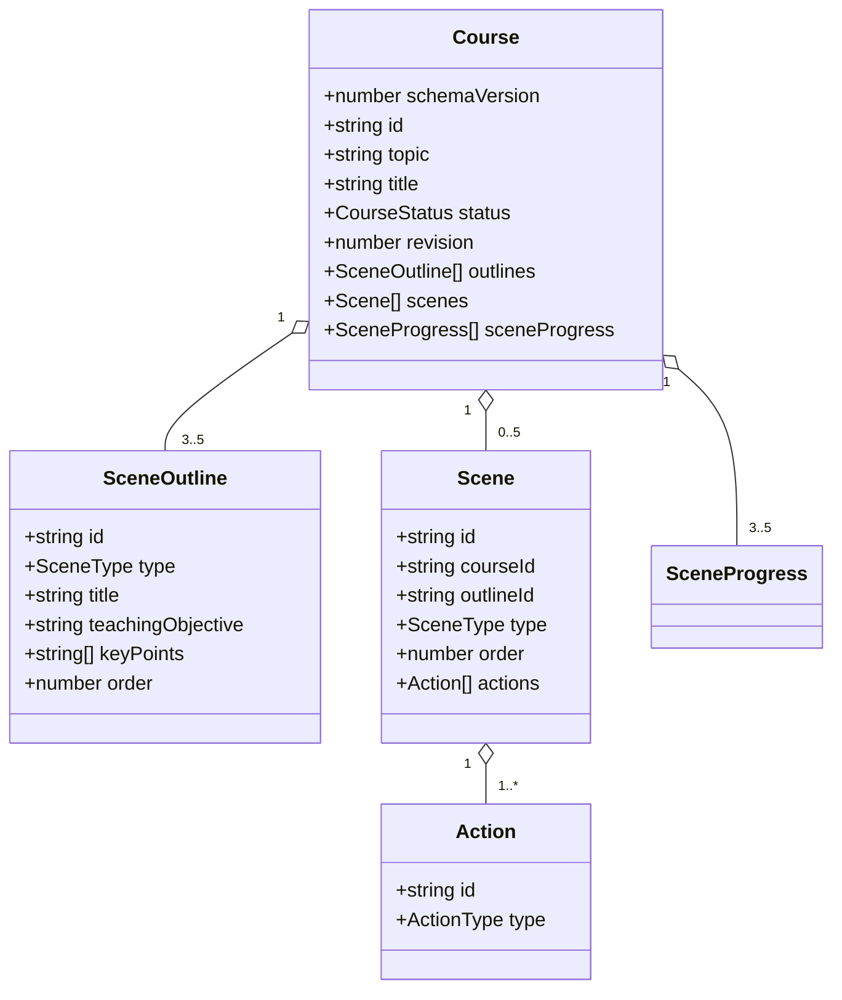

# 04. 领域模型与数据契约

> 文档版本：0.4
> 目标：为页面、API、生成管线、播放器和 MySQL Repository 提供唯一数据语言。  
> 状态说明：Course schemaVersion 3、CourseBrief、SceneOutlineV2 与只读 Slide/PPTElement 已进入正式调用链；第 1～15 节保留 v0.3 基础契约说明，第 16 节记录 v0.4 增量。冲突时以 `lib/domain` 中的 TypeScript + Zod 为可执行来源。

## 1. 建模原则

1. **模型输出不是领域实体**：大模型返回 DTO，系统装配 id、状态、顺序和时间戳；
2. **判别联合保证渲染安全**：`scene.type` 必须与 `content.type` 一致；
3. **生成状态显式持久化**：刷新后不靠内存猜测哪一步完成；
4. **Action 是唯一播放指令**：播放器不从页面文本隐式推导行为；
5. **一处定义，多处复用**：API、客户端和存储导入同一套 Zod Schema；
6. **先小后扩**：只有 Schema、装配器、Renderer/Executor、迁移和测试同时存在的类型才能进入当前版本。

## 2. 聚合关系



Course 是聚合根。外部代码不能单独持久化 Scene 或 SceneOutline，必须通过 CourseRepository 保存满足整体不变量的新 Course。

## 3. 基础类型

```ts
export const CURRENT_SCHEMA_VERSION = 3 as const;

export type CourseStatus =
  | 'draft'
  | 'outlining'
  | 'outline_ready'
  | 'generating'
  | 'partial_failed'
  | 'ready'
  | 'failed';

export type SceneType = 'slide' | 'quiz';

export type SceneGenerationStatus =
  | 'pending'
  | 'generating'
  | 'ready'
  | 'failed';

export type ProviderId = 'mock' | 'deepseek' | 'bailian';

export interface GenerationMetadata {
  provider: ProviderId;
  model: string;
  promptVersion: string;
  requestId: string;
  durationMs: number;
  upstreamCalls: number;
  repaired: boolean;
  usage?: { inputTokens?: number; outputTokens?: number };
  generatedAt: number;
}

export interface GenerationOperation {
  id: string;
  stage: 'outline' | 'scene';
  outlineId?: string;
  startedAt: number;
  expiresAt: number;
}

export interface DomainError {
  code: string;
  message: string;
  retryable: boolean;
  stage?: 'outline' | 'scene' | 'storage' | 'playback';
  details?: Record<string, unknown>;
}
```

Course、Outline、Scene、Action、Question 和 Option 的系统 ID 统一由应用使用 `crypto.randomUUID()` 创建。文档示例中的可读 ID 仅为方便说明，不是另一套生产格式；模型永远不能提供或覆盖实体 ID。

`DomainError.details` 只保存可序列化、无敏感信息的诊断字段。不得放入 Error 对象、API Key、完整 Prompt 或原始模型响应。

## 4. Course 聚合根

```ts
export interface Course {
  schemaVersion: typeof CURRENT_SCHEMA_VERSION;
  id: string;
  topic: string;
  title: string;
  requestedSceneCount: number;
  status: CourseStatus;
  revision: number;
  brief: CourseBrief;
  briefResolution: CourseBriefResolution;
  outlines: SceneOutline[];
  scenes: Scene[];
  sceneProgress: SceneProgress[];
  outlineGeneration?: GenerationMetadata;
  activeOperation?: GenerationOperation;
  lastError?: DomainError;
  createdAt: number;
  updatedAt: number;
}

export interface SceneProgress {
  outlineId: string;
  status: SceneGenerationStatus;
  attempts: number;
  lastError?: DomainError;
  updatedAt: number;
}
```

### Course 不变量

- `schemaVersion === 3`；
- 新课程必须包含非空 CourseBrief；M7.1 中 `interactionMode === 'off'`；
- `id` 非空且创建后不可修改；
- `topic.trim().length` 为 2～500；
- `requestedSceneCount` 为 3～5 的整数；
- revision 为从 0 开始的非负整数，只能由 Repository 在成功提交时递增；
- outline_ready 及之后状态必须有与 requestedSceneCount 相同数量的大纲；
- outlines 的 id 唯一，order 为从 1 开始的连续整数；
- scenes 的 id 和 outlineId 唯一；
- 每个 Scene.outlineId 必须引用当前 Course 的大纲；
- Scene.courseId 必须等于 Course.id；
- Scene.type、Scene.content.type 和对应 Outline.type 三者一致；
- sceneProgress 必须与 outlines 一一对应；
- ready 状态要求所有 progress 与 scenes 均 ready；
- partial_failed 要求至少一个 failed，且至少一个场景没有完成；
- activeOperation 存在时必须与当前 outlining 或 generating 状态一致；迟到结果只有 operation id 和 expectedRevision 同时匹配才允许提交；
- `updatedAt >= createdAt`。

状态字段不是装饰信息。页面恢复、允许操作和验收逻辑都只能依赖这些显式状态。

## 5. SceneOutline

```ts
export interface SceneOutline {
  id: string;
  type: SceneType;
  title: string;
  teachingObjective: string;
  keyPoints: string[];
  order: number;
  estimatedMinutes?: number;
}
```

约束：

- title 为 1～80 个字符；
- teachingObjective 为 1～300 个字符；
- keyPoints 为 2～5 项，每项 1～160 个字符；
- order 由服务端标准化，不接受重复；
- 至少一个 quiz，且 quiz 不应作为第一场景；
- MVP 最多两个 quiz，避免课程被测验占满；
- estimatedMinutes 可选，若存在则为 1～20。

“至少一个 quiz”属于课程级语义规则，不能只靠单个 SceneOutline Schema 判断，应由 `validateCourseOutline` 检查。

## 6. Scene 判别联合

```ts
interface SceneBase {
  id: string;
  courseId: string;
  outlineId: string;
  title: string;
  summary: string;
  order: number;
  actions: Action[];
  generation: GenerationMetadata;
  createdAt: number;
  updatedAt: number;
}

export type Scene = SlideScene | QuizScene;

export interface SlideScene extends SceneBase {
  type: 'slide';
  content: SlideContent;
}

export interface QuizScene extends SceneBase {
  type: 'quiz';
  content: QuizContent;
}
```

summary 是供下一场景生成使用的短摘要，限制为 1～300 个字符。narration 不重复存成字段，而是在装配时转换为 speech Action，避免出现两份讲解文本相互漂移。

不使用下面这种宽松结构：

```ts
// 禁止：type 和 content 可以互相矛盾
interface BadScene {
  type: 'slide' | 'quiz';
  content: SlideContent | QuizContent;
}
```

## 7. v0.3 Slide 内容（历史契约）

v0.3/v2 幻灯片曾采用以下固定内容块；当前 v3 已改为第 16.4 节的 `content.canvas: Slide`，不再读取该联合。这里保留旧定义只用于解释历史基线和版本拒绝原因，不能用于新代码。

```ts
export interface SlideContent {
  type: 'slide';
  subtitle?: string;
  blocks: SlideBlock[];
}

export type SlideBlock =
  | ParagraphBlock
  | BulletListBlock
  | CalloutBlock
  | CodeBlock;

export interface ParagraphBlock {
  id: string;
  type: 'paragraph';
  text: string;
}

export interface BulletListBlock {
  id: string;
  type: 'bullet_list';
  items: string[];
}

export interface CalloutBlock {
  id: string;
  type: 'callout';
  tone: 'info' | 'example' | 'warning';
  title?: string;
  text: string;
}

export interface CodeBlock {
  id: string;
  type: 'code';
  language: string;
  code: string;
  caption?: string;
}
```

约束：

- 每页 1～5 个 blocks；
- paragraph.text 为 1～500 个字符；
- bullet_list 为 2～6 项，每项 1～180 个字符；
- callout.text 为 1～400 个字符；
- code.language 为 1～32 个安全标识字符，code 为 1～6,000 个字符，caption 最多 120 个字符；
- CodeBlockRenderer 必须把 code 当纯文本转义；语法高亮不能使用 `dangerouslySetInnerHTML` 注入模型原文；
- block id 唯一并由装配器生成；
- 所有页面可见文本总量设置上限，避免模型返回不可阅读的“文字墙”。

自由坐标、图片、图表、公式和动画均不进入 v0.3 MVP。M8 只在新 `content.canvas` 分支增加 `text/shape/line/code` 绝对坐标元素；旧 Block 仍保持原义。M8 的 text 只接受净化后的有限富文本，其他普通文本字段仍不得塞入任意 HTML。

## 8. Quiz 内容

```ts
export interface QuizContent {
  type: 'quiz';
  questions: SingleChoiceQuestion[];
}

export interface SingleChoiceQuestion {
  id: string;
  type: 'single_choice';
  prompt: string;
  options: QuizOption[];
  correctOptionId: string;
  explanation: string;
}

export interface QuizOption {
  id: string;
  label: string;
}
```

约束：

- 每个 quiz 场景包含 1～3 题；
- prompt 为 1～300 个字符；
- 每题 2～4 个选项；
- option.id 在题内唯一；
- correctOptionId 必须引用现有选项；
- explanation 为 1～500 个字符；
- 判分完全由本地代码完成；
- 用户作答状态不写回 Course 文档，单独使用 `QuizAttempt` 记录，避免修改生成内容。

```ts
export interface QuizAttempt {
  courseId: string;
  sceneId: string;
  questionId: string;
  selectedOptionId: string;
  correct: boolean;
  submittedAt: number;
}
```

QuizAttempt 保存到 MySQL 独立 quiz_attempts 表；删除 Course 时通过外键或同一事务级联删除。

## 9. Action

```ts
export type Action = SpeechAction | PauseAction;

export interface ActionBase {
  id: string;
}

export interface SpeechAction extends ActionBase {
  type: 'speech';
  text: string;
  rate?: number;
}

export interface PauseAction extends ActionBase {
  type: 'pause';
  reason: 'timed' | 'learner';
  durationMs?: number;
}
```

约束：

- 每个 Scene 至少有一个非空 speech；
- speech.text 为 1～1,500 个字符；
- rate 若存在则为 0.5～2；
- timed pause 必须有 0～30,000 的 durationMs；
- learner pause 不允许 durationMs；
- quiz 的最后一个 Action 必须是 learner pause；
- slide 不应包含 learner pause；
- Action id 在 Scene 内唯一。

MVP 的 Action 由系统装配：

```ts
function buildActions(type: SceneType, narration: string): Action[] {
  const actions: Action[] = [
    { id: createId(), type: 'speech', text: narration.trim() },
  ];

  if (type === 'quiz') {
    actions.push({
      id: createId(),
      type: 'pause',
      reason: 'learner',
    });
  }

  return actions;
}
```

模型不直接返回 Action id，也不能注入未知 action.type。

## 10. 模型 DTO 与领域实体分离

### 10.1 大纲模型输出

```ts
export interface OutlineModelOutput {
  courseTitle: string;
  outlines: Array<{
    type: SceneType;
    title: string;
    teachingObjective: string;
    keyPoints: string[];
    order: number;
    estimatedMinutes?: number;
  }>;
}
```

解析后由 `assembleCourseOutline`：

1. 规范化字符串；
2. 按 order 排序并重新编号；
3. 为每项生成 outline id；
4. 检查课程级不变量；
5. 返回可以交给客户端的 `CourseOutlineDTO`。

### 10.2 场景模型输出

```ts
export type SlideBlockModelOutput =
  | { type: 'paragraph'; text: string }
  | { type: 'bullet_list'; items: string[] }
  | { type: 'code'; language: string; code: string; caption?: string }
  | {
      type: 'callout';
      tone: 'info' | 'example' | 'warning';
      title?: string;
      text: string;
    };

export interface SlideContentModelOutput {
  subtitle?: string;
  blocks: SlideBlockModelOutput[];
}

export interface QuizContentModelOutput {
  questions: Array<{
    type: 'single_choice';
    prompt: string;
    options: Array<{ label: string }>;
    correctOptionIndex: number;
    explanation: string;
  }>;
}

export type SceneModelOutput =
  | {
      type: 'slide';
      title: string;
      content: SlideContentModelOutput;
      narration: string;
      summary: string;
    }
  | {
      type: 'quiz';
      title: string;
      content: QuizContentModelOutput;
      narration: string;
      summary: string;
    };
```

模型 DTO 在类型层面就没有 block/question/option id，也不能提供 correctOptionId。装配器检查 correctOptionIndex 后统一补齐实体 ID、content 判别字段、引用、summary、Action 和时间戳。

### 10.3 API DTO

```ts
export interface CourseOutlineDTO {
  courseTitle: string;
  outlines: SceneOutline[];
}

export interface CourseResponseDTO {
  course: Course;
}
```

大纲和场景模型 DTO 只在服务端生成层内部流动。面向浏览器的课程变更 API 返回已经事务提交的 CourseResponseDTO；Course 状态转换由服务端应用服务完成，客户端不能自行提交任意状态字符串。

## 11. 状态转换

所有 Course.status 修改必须经纯函数，禁止在组件中随意赋字符串。

```ts
type CourseEvent =
  | { type: 'OUTLINE_REQUESTED' }
  | { type: 'OUTLINE_SUCCEEDED'; outline: CourseOutlineDTO }
  | { type: 'OUTLINE_FAILED'; error: DomainError }
  | { type: 'OUTLINE_CONFIRMED' }
  | { type: 'SCENE_STARTED'; outlineId: string }
  | { type: 'SCENE_SUCCEEDED'; scene: Scene }
  | { type: 'SCENE_FAILED'; outlineId: string; error: DomainError }
  | { type: 'GENERATION_FINISHED' };

export function reduceCourse(course: Course, event: CourseEvent): Course;
```

关键规则：

- OUTLINE_REQUESTED：draft/failed → outlining；
- OUTLINE_SUCCEEDED：outlining → outline_ready；
- OUTLINE_CONFIRMED：outline_ready → generating，并创建全部 pending progress；
- SCENE_STARTED：仅 pending/failed → generating，attempts + 1；
- SCENE_SUCCEEDED：替换同 outlineId 的 Scene，progress → ready；
- SCENE_FAILED：保留已有 Scene，progress → failed；
- GENERATION_FINISHED：全 ready → ready；否则有 failed → partial_failed。

非法转换返回 Result 错误或抛出专用 DomainInvariantError，不能静默修改。

## 12. 播放状态

```ts
export type PlaybackMode =
  | 'idle'
  | 'playing'
  | 'paused'
  | 'awaitingLearner'
  | 'completed';

export interface PlaybackState {
  courseId: string;
  sceneIndex: number;
  actionIndex: number;
  mode: PlaybackMode;
}
```

播放状态是运行时数据，不属于 Course 生成文档。MVP 可把语音开关和最近播放游标保存在 localStorage；它们丢失只影响界面便利性，不影响课程内容。课程 revision 改变后若游标越界，应钳制到合法位置。

## 13. MySQL 持久化模型

MySQL 是课程事实的唯一持久化来源。MVP 采用“关系型元数据 + JSON 聚合字段”的一张课程主表，避免过早把 Scene 和 Action 拆成大量可独立修改的行。

| 表 | 关键列 | 内容 |
|---|---|---|
| courses | id、schema_version、revision、topic、title、status、requested_scene_count | Course 顶层字段 |
| courses | outlines_json、scenes_json、scene_progress_json、outline_generation_json、active_operation_json、last_error_json | 聚合内嵌值 |
| courses | created_at、updated_at | 数据库时间戳 |
| quiz_attempts | id、course_id、scene_id、question_id、selected_option_id、correct、submitted_at | 单用户测验记录，course_id 外键级联删除 |

MySQL JSON 只是存储表示，不能替代领域 Schema。Repository 负责在行和 Course 之间映射；业务代码看不到 `*_json` 列。

Course.schemaVersion 描述课程文档格式，数据库迁移版本描述表结构，两者必须分别管理。升级表结构不一定改变 Course.schemaVersion；改变 Course 字段语义则必须提供文档迁移。

CourseRepository 接口：

```ts
export interface CourseRepository {
  create(course: Course): Promise<Course>;
  get(id: string): Promise<Course | null>;
  list(): Promise<CourseSummary[]>;
  save(course: Course, expectedRevision: number): Promise<Course>;
  delete(id: string): Promise<void>;
}
```

create/save 在写入前调用 CourseSchema.parse；get 在读取并组装后再次校验。save 使用 `WHERE id = ? AND revision = ?` 更新并令 revision 加一，影响行数为 0 时返回 `COURSE_CONFLICT`。读取到 `schemaVersion > CURRENT_SCHEMA_VERSION` 时必须报 `FUTURE_SCHEMA_VERSION`，不能猜测兼容。

大纲或场景生成不能在模型调用期间长期持有数据库事务。应用服务先用短事务登记 activeOperation，再调用模型，最后用 operation id + expectedRevision 的第二个短事务提交成功或失败结果。进程崩溃后，超过 expiresAt 的操作才能被恢复为可重试状态。

## 14. 示例文档

```json
{
  "schemaVersion": 1,
  "id": "course_tcp_01",
  "topic": "TCP 拥塞控制",
  "title": "从拥塞现象到拥塞控制算法",
  "requestedSceneCount": 3,
  "status": "generating",
  "revision": 6,
  "outlineGeneration": {
    "provider": "deepseek",
    "model": "deepseek-v4-flash",
    "promptVersion": "outline-v1",
    "requestId": "req_outline_01",
    "durationMs": 3240,
    "upstreamCalls": 1,
    "repaired": false,
    "generatedAt": 1787471950000
  },
  "activeOperation": {
    "id": "op_scene_02",
    "stage": "scene",
    "outlineId": "outline_02",
    "startedAt": 1787472000000,
    "expiresAt": 1787472120000
  },
  "outlines": [
    {
      "id": "outline_01",
      "type": "slide",
      "title": "为什么会发生拥塞",
      "teachingObjective": "理解发送速率超过网络承载能力时的现象",
      "keyPoints": ["队列增长", "丢包", "时延上升"],
      "order": 1
    },
    {
      "id": "outline_02",
      "type": "slide",
      "title": "拥塞窗口如何变化",
      "teachingObjective": "理解窗口与发送速率的关系",
      "keyPoints": ["拥塞窗口", "反馈调节"],
      "order": 2
    },
    {
      "id": "outline_03",
      "type": "quiz",
      "title": "拥塞控制理解检查",
      "teachingObjective": "检查对拥塞形成和窗口调节的理解",
      "keyPoints": ["排队", "窗口变化"],
      "order": 3
    }
  ],
  "scenes": [
    {
      "id": "scene_01",
      "courseId": "course_tcp_01",
      "outlineId": "outline_01",
      "type": "slide",
      "title": "为什么会发生拥塞",
      "summary": "发送流量持续高于网络承载能力时，排队、时延升高和丢包会依次显现。",
      "order": 1,
      "content": {
        "type": "slide",
        "blocks": [
          {
            "id": "block_01",
            "type": "bullet_list",
            "items": ["路由器缓冲区有限", "输入流量长期高于输出能力", "排队和丢包相继发生"]
          }
        ]
      },
      "actions": [
        {
          "id": "action_01",
          "type": "speech",
          "text": "先从路由器队列的变化理解网络拥塞。"
        }
      ],
      "generation": {
        "provider": "deepseek",
        "model": "deepseek-v4-flash",
        "promptVersion": "scene-v1",
        "requestId": "req_scene_01",
        "durationMs": 4810,
        "upstreamCalls": 1,
        "repaired": false,
        "generatedAt": 1787472000000
      },
      "createdAt": 1787472000000,
      "updatedAt": 1787472000000
    }
  ],
  "sceneProgress": [
    {
      "outlineId": "outline_01",
      "status": "ready",
      "attempts": 1,
      "updatedAt": 1787472000000
    },
    {
      "outlineId": "outline_02",
      "status": "generating",
      "attempts": 1,
      "updatedAt": 1787472000000
    },
    {
      "outlineId": "outline_03",
      "status": "pending",
      "attempts": 0,
      "updatedAt": 1787472000000
    }
  ],
  "createdAt": 1787471900000,
  "updatedAt": 1787472000000
}
```

这是一个通过首个场景后仍处于 generating 的有效 Course。完整 ready Course 必须实际包含与 requestedSceneCount 一致的 outlines、scenes 和 sceneProgress。

## 15. 演进规则

- 增加可选字段且旧读者允许时，可保持 schemaVersion；
- 删除字段、改变 Course 顶层语义或存储布局时必须升级 Course schemaVersion；新增 slide/interactive 判别分支仍必须保持旧分支可读，互动消息协议可独立使用 `runtimeContractVersion`；
- 每次版本升级必须明确选择“迁移”或“保留旧行并拒绝读取”；当前 v1/v2 采用后者，不伪造新内容；
- 新 Scene 类型只有在 Schema、Renderer、生成器和测试同时存在时才能加入；
- 新 Action 类型只有在 Schema、Executor、取消语义和测试同时存在时才能加入；
- 不允许用 `any` 绕开外部输入校验，也不允许用类型断言代替运行时验证。

## 16. v0.4/M7～M10 契约：Course schemaVersion 3

### 16.1 版本兼容策略

M7.1 曾以 `schemaVersion: 2` 引入 CourseBrief 和 SceneOutlineV2；M8 删除 block slide 并把唯一 slide 表达改为 `content.canvas`，因此当前 Course 聚合升级到 `schemaVersion: 3`。本阶段明确不兼容旧课程：Repository 不自动删除或改写旧行，也不把 v1/v2 内容交给当前 Schema。读取顺序为：

```text
MySQL row
  → schema_version = 3：CurrentCourseSchema(v3)
  → schema_version = 1/2：LEGACY_COURSE_UNSUPPORTED
  → schema_version > 3：FUTURE_COURSE_SCHEMA_VERSION
  → 应用服务
```

`brief_json` 继续存储 `{ brief, resolution }`。新建 v3 Course 必须写入非空 provisional brief；`outline.v2.1` 成功后在保存大纲的同一事务中写入 resolved brief 和来源信息。`list()` 只查询 v3，按旧 ID 读取明确拒绝；旧行既不会丢失，也不会被伪装成符合当前画布契约的课程。

### 16.2 CourseBrief

```ts
export interface CourseBrief {
  audience: string;
  learnerLevel: 'beginner' | 'intermediate' | 'advanced';
  learningGoal: string;
  prerequisites: string[];
  durationMinutes: 10 | 15 | 20;
  teachingStyle: 'structured' | 'case_based' | 'practice_oriented';
  interactionMode: 'off' | 'auto' | 'required';
  additionalRequirements: string[];
}

export type CourseBriefOverrides = Partial<CourseBrief>;
export type CourseBriefField = keyof CourseBrief;
export type BriefValueSource = 'explicit_setting' | 'prompt' | 'default';

export interface BriefResolutionWarning {
  code: 'SETTING_PROMPT_CONFLICT' | 'PROMPT_AMBIGUOUS' | 'SCOPE_TOO_BROAD';
  field?: CourseBriefField;
  message: string;
}

export interface CourseBriefResolution {
  status: 'provisional' | 'resolved';
  sources: Record<CourseBriefField, BriefValueSource>;
  warnings: BriefResolutionWarning[];
  resolvedAt?: string;
}

export interface StoredCourseBriefV2 {
  brief: CourseBrief;
  resolution: CourseBriefResolution;
}

export interface CourseV2 extends Omit<CourseV1, 'schemaVersion' | 'outlines' | 'scenes'> {
  schemaVersion: 2;
  brief: CourseBrief;
  briefResolution: CourseBriefResolution;
  outlines: SceneOutlineV2[];
  scenes: Scene[]; // M7.1 的历史 block slide 联合
}

// M8 当前聚合只改变版本截止线和 slide 内容分支；Brief/Outline 字段沿用 v2。
export interface CourseV3 extends Omit<CourseV2, 'schemaVersion' | 'scenes'> {
  schemaVersion: 3;
  scenes: SceneV3[];
}
```

`Course.topic` 保留用户提交的原始课程描述，`CourseBrief` 保存系统最终采用的结构化解释，两者不能互相覆盖。`audience` 回答“讲给谁”，`learnerLevel` 回答“已有知识到什么程度”；例如 audience 可以是“大一非计算机专业学生”，learnerLevel 可以是 beginner。`additionalRequirements` 只收纳用户明确写出的跨字段要求，不把模型建议伪装成用户要求。

约束：

- audience 为 1～120 个字符；
- learningGoal 为 2～300 个字符；
- prerequisites 为 0～5 项，每项 1～120 个字符，规范化后不能重复；
- additionalRequirements 为 0～5 项，每项 1～160 个字符，规范化后不能重复；
- 只有 topic 仍为必填用户输入；`briefOverrides` 中字段缺失表示“未显式设置”，显式 `[]` 表示用户确认列表为空，两者不能在请求解析时合并；
- 默认值为“无特定专业背景的学习者”、beginner、15 分钟、case_based、off、空先修知识和空附加要求，并从 topic 构造不超过 300 字的通用学习目标；M9 才开放 auto/required；
- 字段来源优先级固定为 `explicit_setting > prompt > default`，模型只能报告 Prompt 中能定位到的明确要求；
- 创建成功时 resolution 为 provisional；outline.v2 成功后变为 resolved，并和大纲使用同一个 Course revision；
- 场景生成接口不得接受另一份 brief 覆盖 Course.brief；它只使用仓储加载的 resolved Brief。

解析生命周期如下：

```text
CreateCourseRequest(topic, briefOverrides?)
  → applyDefaults(briefOverrides)                       // provisional
  → INSERT Course(topic 原文, brief_json)
  → outline.v2.1(topic, explicit settings, defaults)
  → detectedPromptFields + warnings + outlines
  → resolveBrief(explicit settings, detected fields, defaults)
  → 同事务保存 brief + resolution + outlines          // resolved
```

Prompt 已经写明的字段使用 `prompt` 来源，未写明的字段逐项回落到 `default`，不能把一次“部分解析”当成整份 Brief 都来自 Prompt。描述与高级设置冲突时保留高级设置并记录 `SETTING_PROMPT_CONFLICT`；相同值不产生冲突警告。用户在确认大纲前通过 Brief 编辑接口修改字段时，这些字段改为 `explicit_setting`，旧 outlines 被清空或标记失效，Course 返回可重新生成大纲的状态。场景已开始生成后 M7.1 拒绝直接修改整课 Brief。

不为 v1 历史内容补造默认 Brief 或字段来源。这样避免把当前默认值错误归因到旧生成结果，也避免为了兼容旧场景长期保留双写和双校验分支。

### 16.3 SceneOutlineV2

```ts
export type SceneTypeV2 = 'slide' | 'quiz' | 'interactive';

export type SceneRole =
  | 'hook'
  | 'concept'
  | 'mechanism'
  | 'worked_example'
  | 'practice'
  | 'summary'
  | 'assessment';

export interface SceneOutlineV2 {
  id: string;
  type: SceneTypeV2;
  role: SceneRole;
  title: string;
  teachingObjective: string;
  keyPoints: string[];
  misconceptions?: string[];
  assessmentFocus?: string;
  widgetType?: 'diagram';
  order: number;
  estimatedMinutes?: number;
}
```

除 v1 规则外，v2 课程级不变量为：

- role 必须与教学目标一致，但不强制每门课机械包含所有 role；
- misconceptions 为 0～3 项，每项 1～160 个字符；
- quiz 应使用 `assessment`，也可以在需要即时练习时使用 `practice`；
- interactive 必须提供 `widgetType: 'diagram'`，其他 Scene 不得提供 widgetType；
- `interactionMode=off` 时 interactive 数量为 0，`auto` 时为 0～1，`required` 时恰好为 1；
- interactive 不能是第一场，且其 teachingObjective 必须引用课程中已引入的概念；
- requestedSceneCount 在 v2 仍为 3～5，至少一个 quiz、最多两个 quiz 的规则不变。

### 16.4 GeneratedSlideData、Slide 与有限 PPTElement

M8 采用 OpenMAIC 的直接元素生成方式。模型 DTO 与持久化实体仍然分开，但二者之间不增加另一份语义页面计划：模型直接给出背景和带坐标的元素，服务端做轻量规范化并装配 Slide。

```ts
export interface GeneratedSlideSceneDTO {
  type: 'slide';
  content: {
    elements: GeneratedPPTElement[];
    background?: SlideBackground;
  };
  narration: string;
  summary: string;
}

export type GeneratedPPTElement =
  | Omit<PPTTextElement, 'id'>
  | Omit<PPTShapeElement, 'id'>
  | Omit<PPTLineElement, 'id'>
  | GeneratedCodeElement;

export interface PPTBaseElement {
  id: string;
  left: number;
  top: number;
  width: number;
  height: number;
  rotate: number;
}

export interface PPTTextElement extends PPTBaseElement {
  type: 'text';
  content: string;
  defaultFontName: string;
  defaultColor: string;
  lineHeight?: number;
}

export interface PPTShapeElement extends PPTBaseElement {
  type: 'shape';
  path: string;
  viewBox: [number, number];
  fill: string;
  outline?: PPTElementOutline;
}

export type LinePoint = '' | 'arrow' | 'dot';

export interface PPTLineElement extends Omit<PPTBaseElement, 'height' | 'rotate'> {
  type: 'line';
  start: [number, number];
  end: [number, number];
  curve?: [number, number]; // 可选二次曲线控制点，相对 left/top
  style: 'solid' | 'dashed' | 'dotted';
  color: string;
  points: [LinePoint, LinePoint];
}

export interface PPTCodeElement extends PPTBaseElement {
  type: 'code';
  language: string;
  lines: CodeLine[];
  fileName?: string;
  showLineNumbers?: boolean;
  fontSize?: number;
}

export interface CodeLine {
  id: string;
  content: string;
}

export interface GeneratedCodeElement extends Omit<PPTCodeElement, 'id' | 'lines'> {
  lines: string[];
}

export type SupportedPPTElement =
  | PPTTextElement
  | PPTShapeElement
  | PPTLineElement
  | PPTCodeElement;

export interface Slide {
  id: string;
  viewportSize: 1000;
  viewportRatio: 0.5625;
  theme: SlideTheme;
  elements: SupportedPPTElement[];
  background?: SlideBackground;
}

export interface CanvasSlideContent {
  type: 'slide';
  canvas: Slide;
}

export interface SlideSceneV3 extends SceneBase {
  type: 'slide';
  content: CanvasSlideContent;
}
```

上述代码表达职责边界，不要求逐字段复制 OpenMAIC 的完整超集。真正实施时应从固定提交的 [`slides.ts`](https://github.com/THU-MAIC/OpenMAIC/blob/59adbef03b63488a7ff1ea983cf0fbba51609f9f/packages/%40openmaic/dsl/src/slides.ts) 中裁出四类元素实际需要的字段，避免为了兼容图片、视频、图表、表格、音频、复杂公式、动画和编辑器而扩大联合。固定提交的生成 DTO 本身没有 code 分支，但 DSL 有 `PPTCodeElement`；本项目需要把现有安全只读代码块显式适配进去。

模型可以提交坐标、尺寸和允许的样式，这是复用 OpenMAIC Prompt 版式能力的关键；模型不能提交或控制元素/代码行 id、Course/Scene id、outlineId、order、status、revision 和 Action。规范化步骤忽略模型 id，补齐有限默认值，过滤未支持元素，拒绝非有限坐标、非正尺寸和关键字段缺失，并在服务端为元素与代码行生成 id。个别坏元素可以丢弃；全部元素无效时整个场景生成失败。

`PPTTextElement.content` 在 OpenMAIC 中是富文本 HTML。本项目只允许 `p/span/strong/b/em/i/u/br` 和 `font-size/color/text-align/line-height/font-weight/text-decoration` 六类受限样式，装配前统一净化，不能把上游 Renderer 的信任边界原样复制。code 始终作为源码数据转义渲染，不进入富文本路径。

`content.canvas` 是当前 slide 的唯一产品表达，表示一张固定 16:9 的 PPT 式页面；它不是 HTML `<canvas>` 标签，也不是无限白板。旧 `SlideContent.blocks` 不再进入当前联合或 Renderer，v1/v2 课程由版本门整体拒绝。

OpenMAIC 固定提交的 [`pipeline-types.ts`](https://github.com/THU-MAIC/OpenMAIC/blob/59adbef03b63488a7ff1ea983cf0fbba51609f9f/packages/%40openmaic/generation/src/pipeline-types.ts) 是模型响应参考，[`normalize.ts`](https://github.com/THU-MAIC/OpenMAIC/blob/59adbef03b63488a7ff1ea983cf0fbba51609f9f/packages/%40openmaic/dsl/src/normalize.ts) 是默认值与单元素规范化参考，[`scene-builder.ts`](https://github.com/THU-MAIC/OpenMAIC/blob/59adbef03b63488a7ff1ea983cf0fbba51609f9f/packages/%40openmaic/generation/src/scene-builder.ts) 是 `1000/0.5625` 和 `content.canvas` 装配参考。直接移植时必须保留 MIT 许可和来源记录。

### 16.5 InteractiveScene

```ts
export interface InteractiveFallback {
  title: string;
  description: string;
  steps: string[];
}

export interface InteractiveContent {
  type: 'interactive';
  widgetType: 'diagram';
  runtimeContractVersion: 1;
  html: string;
  fallback: InteractiveFallback;
}

export interface InteractiveScene extends SceneBase {
  type: 'interactive';
  content: InteractiveContent;
}

export type QuizSceneV3 = QuizScene;
export type SceneV3 = SlideSceneV3 | QuizSceneV3;
export type FutureSceneWithInteractive = SceneV3 | InteractiveScene;
```

约束：

- html 为完整、自包含文档，UTF-8 字节长度不超过 100 KiB；
- html 不接受 url fallback，不允许外部网络依赖；
- fallback.title 为 1～100 字，description 为 1～500 字，steps 为 2～8 项；
- runtimeContractVersion 当前只能为 1；
- InteractiveScene 至少有 speech，最后一个 Action 为 learner pause；
- iframe 内的临时交互状态不写入 Course；刷新后重新初始化 widget，但生成内容、fallback 和完成前的课程事实仍可恢复；
- runtime error 只进入 UI 诊断/遥测，不允许脚本直接修改 Course。

### 16.6 互动消息联合

```ts
export type WidgetToHostMessage =
  | { type: 'INTERACTIVE_READY'; contractVersion: 1 }
  | { type: 'INTERACTIVE_COMPLETED'; contractVersion: 1 }
  | { type: 'INTERACTIVE_ERROR'; contractVersion: 1; message: string };

export type HostToWidgetMessage =
  | { type: 'INTERACTIVE_RESET'; contractVersion: 1 };
```

所有消息使用 `.strict()` Schema，message 最多 300 字。宿主必须先验证 `event.source === iframe.contentWindow`，再验证消息；不得仅凭 `event.origin`，因为无同源权限的 srcDoc iframe 使用不透明来源。

OpenMAIC 固定提交的 [`interactive.ts`](https://github.com/THU-MAIC/OpenMAIC/blob/59adbef03b63488a7ff1ea983cf0fbba51609f9f/packages/%40openmaic/dsl/src/interactive.ts) 可参考内容判别，[`InteractiveIframeHost.tsx`](https://github.com/THU-MAIC/OpenMAIC/blob/59adbef03b63488a7ff1ea983cf0fbba51609f9f/components/scene-renderers/InteractiveIframeHost.tsx) 可参考 iframe 与 `event.source` 绑定；本项目的 sandbox 只允许 `allow-scripts`，不继承参考实现中的 forms/popups 权限。

### 16.7 再生成替换不变量

- 再生成只允许替换同一个 courseId + outlineId 的 ready Scene；
- 候选 Scene 沿用 courseId、outlineId、type 和 order，获得新的 scene id、PPTElement/旧 Block id、Action id、GenerationMetadata 和时间戳；
- 新候选未通过完整校验和事务提交前，旧 Scene 保持在聚合中；
- 候选生成期间 Course.status、SceneProgress 和持久化 activeOperation 都保持不变；最终 expectedRevision 不匹配时拒绝迟到结果，因此崩溃或取消天然回到旧 ready 场景；
- quiz 场景再生成必须要求用户确认旧作答会失效；替换 Course Scene 与删除旧 sceneId 的 QuizAttempt 使用同一个 MySQL 事务，任一步失败则全部回滚；
- 互动场景再生成必须重新走 HTML 安全检查和 iframe E2E fixture，不能只校验通用 Scene 字段。

### 16.8 分阶段启用门

Course `schemaVersion: 3` 已随 Slide/PPTElement Schema、轻量规范化、文本净化、只读 Renderer、MySQL 恢复、真实模型 smoke 和 production E2E 同时进入正式调用链。v1/v2 只保留明确拒绝分支，不参与运行时迁移。M9 的 InteractiveScene 也只有在生成器、必要安全边界、iframe Renderer、消息协议、fallback、fixture 和 E2E 同时完成后才能产生；只提前修改联合类型或让模型输出下游尚不能处理的分支，都会破坏阶段可运行性，因此禁止分离发布。
