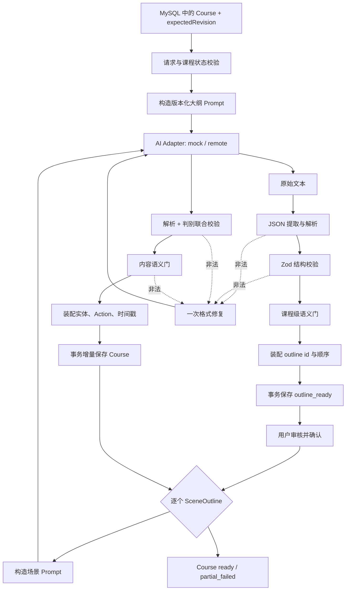

# 05. AI 生成管线设计

> 文档版本：0.2  
> 前置文档：[03-architecture.md](03-architecture.md)、[04-domain-model.md](04-domain-model.md)  
> 核心原则：模型输出先经过不可信边界，再进入领域装配和持久化。

> 实现状态（2026-08-24）：大纲与逐场景链路均已进入正式调用路径，并在 mock + MySQL 下验证；slide/quiz DTO、装配、短事务、失败隔离与单场重试已经实现。DeepSeek/百炼适配器代码已完成，但两家远端真实调用仍等待有效服务端 Key 验收。

## 1. 设计结论

MVP 使用两层结构化生成：

```text
第一层：topic → CourseOutlineDTO
第二层：一个 SceneOutline + 紧凑课程上下文 → GeneratedSceneDTO
```

第二层按场景串行执行。模型生成可见内容和 narration，程序负责生成所有 id、引用、状态、时间戳和 Action。这样既保留 OpenMAIC“先计划、后逐页物化”的可恢复结构，又避免首版为内容和动作分别调用模型带来的成本和复杂度。

## 2. 与 OpenMAIC 的对应关系

OpenMAIC 的浏览器链路为：

```text
scene-outlines-stream
  → scene-content
  → scene-actions
  → optional TTS
  → incremental persistence
```

它还支持按场景类型路由模型、流式大纲、材料视觉输入、Web 搜索、角色生成、媒体生成和失败恢复。MVP 的对应裁剪是：

| OpenMAIC | 本项目 MVP |
|---|---|
| SSE 流式大纲 | 普通 JSON 响应，先保证结构正确 |
| content 与 actions 两次模型调用 | 一次生成 content + narration，程序装配 Action |
| 四类 Scene | slide、quiz |
| 按阶段/类型模型路由 | DeepSeek/百炼二选一；一次运行固定一个 Provider/模型 |
| 多种 JSON 修复策略 | 精确解析 + 代码围栏提取 + 一次模型修复 |
| 默认最多多次传输重试 | 有类型分类、总调用硬上限 |
| 首场景完成即进课堂 | MVP 全部场景结束后进入正式课堂 |
| 图片、视频、云 TTS | 不进入生成管线 |

后续若要研究“动作生成质量”，可以把 Action 生成重新拆成第三阶段，而不改变前两阶段与 CourseRepository。

## 3. 管线总览



## 4. AI Adapter

### 4.1 接口

```ts
export interface GenerateTextInput {
  requestId: string;
  stage: 'outline' | 'scene' | 'repair';
  systemPrompt: string;
  userPrompt: string;
  signal: AbortSignal;
  maxOutputTokens: number;
}

export interface GenerateTextResult {
  text: string;
  provider: 'mock' | 'deepseek' | 'bailian';
  model: string;
  finishReason?: string;
  usage?: {
    inputTokens?: number;
    outputTokens?: number;
  };
}

export interface AIAdapter {
  generateText(input: GenerateTextInput): Promise<GenerateTextResult>;
}
```

GenerationService 只依赖 AIAdapter，不导入具体 Provider SDK。实现包括：

- `MockAIAdapter`：读取确定性 fixture，不访问网络；
- `OpenAICompatibleAdapter`：只在服务端加载，接收经过校验的 ProviderConfig；
- `ProviderConfigResolver`：根据 AI_PROVIDER 选择 DeepSeek 或阿里百炼配置。

### 4.2 环境配置

```env
AI_MODE=mock
# AI_MODE=remote 时从以下两个配置档中选择一个
AI_PROVIDER=deepseek

DEEPSEEK_API_KEY=
DEEPSEEK_BASE_URL=https://api.deepseek.com
DEEPSEEK_MODEL=deepseek-v4-flash

BAILIAN_API_KEY=
# 按百炼地域和业务空间填写 OpenAI-compatible Base URL
BAILIAN_BASE_URL=https://{WorkspaceId}.cn-beijing.maas.aliyuncs.com/compatible-mode/v1
BAILIAN_MODEL=qwen3.6-plus
```

截至 2026-08-23，两个平台都提供 OpenAI-compatible 接口，但模型名、地域 URL 和产品规则会变化，因此它们必须保持为环境配置而不是写死在业务代码中。百炼的 Base URL 必须与 API Key 地域匹配；DeepSeek 和百炼的 Key 不共用。

配置依据以官方文档为准：[DeepSeek API 快速开始](https://api-docs.deepseek.com/quick_start/pricing-details-cny/)、[阿里百炼 Base URL 总览](https://help.aliyun.com/zh/model-studio/base-url)、[百炼 OpenAI 兼容接口](https://help.aliyun.com/zh/model-studio/compatibility-of-openai-with-dashscope)。

启动时只校验当前激活配置档。remote 模式缺少 Key、Base URL 或 Model 时返回 `AI_NOT_CONFIGURED`，不等到用户点击后才抛出模糊错误。切换 Provider 需要修改服务端环境并重启，MVP 不允许浏览器按请求切换。

### 4.3 服务端边界

- AI Adapter 文件使用 `server-only` 或等价约束；
- Route Handler 不接受客户端传入 Key、Base URL 或任意模型名；
- 客户端不能按请求覆盖系统 Prompt；
- 每次调用都有 AbortSignal 和超时；
- SDK 自带重试关闭或纳入统一策略，避免双重重试失控。
- JSON mode 只作为 Provider capability 使用，解析和 Zod 校验永远不能省略。

## 5. 大纲生成接口

### 5.1 请求

`POST /api/courses/{courseId}/outline/generate`

```json
{
  "expectedRevision": 0
}
```

请求约束：

- Content-Type 必须为 JSON；
- courseId 来自 URL，服务端必须从 MySQL 加载 Course；
- expectedRevision 必须等于数据库当前 revision；
- Course 必须处于 draft、failed 或允许重新生成大纲的状态；
- topic 和 sceneCount 只使用数据库中的已校验值，客户端不能在此接口临时覆盖；
- 请求体设置大小上限；
- Route Handler 为请求分配 requestId。

### 5.2 成功响应

成功响应为 `ApiSuccess<CourseResponseDTO>`，其中 data.course 是已经提交到 MySQL 的完整 outline_ready Course，revision 已递增，outlineGeneration 保存实际 Provider、模型、promptVersion、requestId、token usage 和耗时。模型成功但事务失败时不得返回成功。

### 5.3 模型输出

模型输出不包含 id：

```json
{
  "courseTitle": "从网络拥塞到 TCP 拥塞控制",
  "outlines": [
    {
      "type": "slide",
      "title": "拥塞是怎样发生的",
      "teachingObjective": "理解发送速率与网络承载能力的关系",
      "keyPoints": ["队列积压", "时延上升", "丢包"],
      "order": 1,
      "estimatedMinutes": 4
    },
    {
      "type": "slide",
      "title": "拥塞窗口如何调节发送速率",
      "teachingObjective": "理解拥塞窗口对在途数据量的限制",
      "keyPoints": ["拥塞窗口", "发送速率", "反馈调节"],
      "order": 2,
      "estimatedMinutes": 5
    },
    {
      "type": "quiz",
      "title": "拥塞控制理解检查",
      "teachingObjective": "检查对拥塞现象和窗口调节的理解",
      "keyPoints": ["排队现象", "窗口变化"],
      "order": 3,
      "estimatedMinutes": 3
    }
  ]
}
```

### 5.4 大纲语义门

Zod 通过后继续检查：

- 大纲数量恰好等于 sceneCount；
- order 可重新排序但不能缺失内容；
- 只有 slide、quiz；
- 第一场景不是 quiz；
- 至少一个 quiz，最多两个 quiz；
- 标题不可重复；
- teachingObjective 不能全部相同；
- keyPoints 去重后仍满足数量下限；
- courseTitle 不是空白或原始 Prompt 模板片段。

可以确定性修正的内容，如首尾空白、顺序重新编号和重复 keyPoint，直接标准化；会改变教学意图的问题必须判失败或进入修复调用。

## 6. 场景生成接口

### 6.1 请求

`POST /api/courses/{courseId}/scenes/{outlineId}/generate`

```json
{
  "expectedRevision": 4
}
```

courseId 和 outlineId 来自 URL。服务端从 MySQL 加载完整 Course，验证 outline 属于该课程且状态为 pending/failed，再在内部构造 coursePlan 和 previousSummary。客户端不能提交另一份 outline、课程标题或前页摘要来覆盖数据库事实。

coursePlan 只取大纲标题和类型；previousSummary 最多取数据库中前一 ready 场景的短摘要，不累计整门课程，防止上下文无限增长。

### 6.2 slide 模型输出

```json
{
  "type": "slide",
  "title": "拥塞是怎样发生的",
  "content": {
    "subtitle": "当输入长期超过输出能力",
    "blocks": [
      {
        "type": "bullet_list",
        "items": ["路由器队列逐渐增长", "排队时延升高", "缓冲区满后发生丢包"]
      },
      {
        "type": "callout",
        "tone": "example",
        "title": "直觉类比",
        "text": "入口车辆持续多于出口通行能力时，排队会越来越长。"
      },
      {
        "type": "code",
        "language": "text",
        "caption": "发送端控制逻辑示意",
        "code": "if congestion_detected:\n  reduce_congestion_window()"
      }
    ]
  },
  "narration": "先把网络想象成一段有入口和出口的道路……",
  "summary": "网络拥塞源于输入速率长期超过可用转发能力。"
}
```

### 6.3 quiz 模型输出

```json
{
  "type": "quiz",
  "title": "理解检查",
  "content": {
    "questions": [
      {
        "type": "single_choice",
        "prompt": "当输入速率长期超过链路输出能力时，最先出现的趋势是什么？",
        "options": [
          { "label": "队列长度增加" },
          { "label": "往返时延立即归零" },
          { "label": "带宽自动无限增大" }
        ],
        "correctOptionIndex": 0,
        "explanation": "多余数据首先在缓冲区排队，随后才可能因缓冲区耗尽而丢包。"
      }
    ]
  },
  "narration": "下面用一道题检查你是否理解拥塞形成过程。",
  "summary": "检查学习者对排队、时延和丢包先后关系的理解。"
}
```

模型输出使用 `correctOptionIndex`，装配器生成 option id 后把它转换为 `correctOptionId`。索引越界必须失败，不能默认选第一个答案。

### 6.4 场景语义门

共同检查：

- 输出 type 必须等于请求 outline.type；
- title 与大纲主题一致，允许措辞调整但不能为空；
- narration 非空且长度受限；
- summary 非空且长度受限；
- 可见内容不能为空；
- 输出不包含 HTML/script、外部 URL 或未定义字段。

slide 检查：

- blocks 为 1～5 个；
- 总字符量不超过页面上限；
- 至少覆盖大纲关键点中的大部分，MVP 可以用规范化关键词命中率作弱门；
- 不允许连续多个完全相同 Block。
- code block 的 language、code、caption 满足长度约束；代码只作为文本，不允许 HTML、外部脚本或执行指令。

quiz 检查：

- 1～3 题；
- 选项 2～4 个且规范化后不重复；
- correctOptionIndex 在范围内；
- explanation 非空；
- 不出现“以上都对”但答案与其他选项矛盾等可机械发现的问题。

关键词门只能检查形式覆盖，不能宣称事实正确。

## 7. Prompt 设计

Prompt 分为版本化 System Prompt 和 User Prompt：

```text
prompts/
├─ outline.v1.ts
├─ scene-slide.v1.ts
├─ scene-quiz.v1.ts
└─ repair.v1.ts
```

System Prompt 负责角色、硬约束、允许字段和输出格式；User Prompt 只承载本次主题和上下文。模板导出 `PROMPT_VERSION`，日志记录版本，方便以后比较实验。

Prompt 要求：

- 明确“只返回一个 JSON 对象，不要 Markdown”；
- 给出完整但最小的 JSON 示例；
- 明确字段长度、数量和枚举；
- 明确不要生成 id、Action、HTML、链接和额外字段；
- quiz 明确 correctOptionIndex 的语义；
- 不把 Zod Schema 原样无限展开到 Prompt，可维护一份紧凑格式说明；
- 不能依赖“模型应该懂”来代替运行时校验。

## 8. 解析与修复

### 8.1 解析顺序

1. 对原始 text 执行 `trim`；
2. 首先尝试精确 `JSON.parse`；
3. 若失败，只尝试提取一个完整的 ```json` 代码块或首个平衡 JSON 对象；
4. 对解析值执行严格 Zod `.strict()`；
5. 执行领域语义门；
6. 通过后才装配实体。

MVP 不进行大量正则替换和猜测性字段补全。过度“修好”JSON 可能把原本不可判定的内容悄悄变成错误课程。

### 8.2 一次模型修复

解析、Schema 或语义门失败时，可以调用一次 repair Prompt：

```text
给定：
- 原任务的紧凑约束
- 校验错误的字段路径和原因
- 有长度上限的原始输出

要求：
- 只修复格式与违反的约束
- 不改变未报错的教学内容
- 只返回完整 JSON
```

修复结果重新走完整解析和校验。仍失败则返回 `INVALID_MODEL_OUTPUT`，不继续循环。

## 9. 重试、预算与超时

### 9.1 自动重试分类

| 类型 | 示例 | 自动重试 |
|---|---|---|
| 配置/认证 | 400、401、403、422、缺少配置 | 否 |
| 限流/临时上游 | 408、429、5xx | 最多 2 次 |
| 网络 | timeout、连接重置、DNS 临时失败 | 最多 2 次 |
| 用户取消 | AbortError | 否，立即终止 |
| 输出不合法 | JSON/Schema/语义门失败 | 仅 1 次 repair |
| 内部编程错误 | 未知异常 | 否，记录并返回内部错误 |

退避采用 `baseDelay * 2^attempt + jitter`，同时尊重 AbortSignal。

### 9.2 调用硬上限

一门课程最多 5 个场景，正常调用数量为：

```text
1 次 outline + N 次 scene，N ∈ [3,5]
正常总数 = 4～6 次
```

一次自动运行只允许 1 个 outline 请求和 N 个 scene 请求，因此业务请求上限为 `1 + sceneCount`，最多 6 个。单个 API 请求设置 `MAX_UPSTREAM_CALLS_PER_REQUEST = 4`，初次调用、网络重试和 repair 全部计入；到达上限后立即返回 `GENERATION_BUDGET_EXHAUSTED`。由此一次自动运行的上游调用理论硬上限为 24，而正常值仍为 4～6。

每个 Route Handler 独立限制本请求，数据库中的 Course 状态、activeOperation 和 revision 保证同一个 pending outline 在一次自动运行中只提交一次。手动重试是用户明确触发的新请求，仍受单请求上限控制；Course.sceneProgress.attempts 持续累计。响应和持久化 GenerationMetadata 都记录 upstreamCalls，不能只用 HTTP 请求数估算模型成本。

建议超时：

- outline：90 秒；
- scene：120 秒；
- repair：60 秒；
- 客户端离开页面：立即 abort。

超时值必须可配置并有默认值，不能在多个组件散落魔法数字。

## 10. 统一 API 响应

成功：

```ts
interface ApiSuccess<T> {
  success: true;
  data: T;
  meta: {
    requestId: string;
    provider: 'mock' | 'deepseek' | 'bailian';
    model: string;
    attempts: number;
    upstreamCalls: number;
    repaired: boolean;
    durationMs: number;
  };
}
```

失败：

```ts
interface ApiFailure {
  success: false;
  error: {
    code:
      | 'INVALID_REQUEST'
      | 'COURSE_NOT_FOUND'
      | 'INVALID_COURSE_STATE'
      | 'COURSE_CONFLICT'
      | 'DATABASE_UNAVAILABLE'
      | 'AI_NOT_CONFIGURED'
      | 'AI_AUTH_FAILED'
      | 'AI_RATE_LIMITED'
      | 'AI_TIMEOUT'
      | 'AI_UPSTREAM_ERROR'
      | 'INVALID_MODEL_OUTPUT'
      | 'GENERATION_BUDGET_EXHAUSTED'
      | 'INTERNAL_ERROR';
    message: string;
    retryable: boolean;
    requestId: string;
    upstreamCalls: number;
    issues?: Array<{ path: string; message: string }>;
  };
}
```

生产响应不返回完整原始模型文本。开发模式若需诊断，将截断后的响应写入受控服务端日志，不传给浏览器。

## 11. 客户端生成编排

```ts
async function generateCourse(courseId: string, signal: AbortSignal) {
  // 1. 从 Course API 加载 MySQL 中的最新聚合与 revision。
  // 2. 请求大纲 API；服务端生成、校验并事务保存，随后等待用户确认。
  // 3. 逐个请求 pending/failed 场景；每次都携带上次响应的 revision。
  // 4. 每次响应替换客户端 CourseDTO；冲突时停止并重新加载。
}
```

关键规则：

- 客户端不直接修改持久化状态；服务端在模型调用前登记 activeOperation；
- 成功响应再次用共享 Schema 校验，不能盲目信任本项目自己的 API；
- API 只有在 MySQL 提交成功后才返回成功 CourseDTO；
- 刷新时先重新读取数据库；只有超过 expiresAt 的遗留操作才能恢复；
- 重试只选择指定 outlineId；
- 生成中不允许同一 outline 发起第二个请求；
- 一次自动运行最多提交 `1 + sceneCount` 个业务请求，失败后的再次提交必须由用户明确触发；
- 串行完成前不引入并发设置。

## 12. Mock 模式

Mock 是第一个里程碑的主数据源，至少准备：

```text
tests/fixtures/
├─ outline.valid.json
├─ scene-slide.valid.json
├─ scene-quiz.valid.json
├─ outline.invalid.json
└─ scene.invalid.json
```

MockAIAdapter 根据 stage 和 outline.type 返回固定响应，并可通过测试注入错误。它必须经过和 remote 相同的 parse、Zod、语义门、装配器和 MySQL 事务链路，避免出现“mock 能跑、真实链路是另一套代码”。

## 13. 可观测性

每次上游调用记录聚合字段：

- requestId、courseId 的不可逆短哈希；
- stage：outline、scene 或 repair；
- outlineId（若有）；
- provider、model、promptVersion；
- attempt、repaired、finishReason；
- durationMs；
- input/output token usage（Provider 返回时）；
- parsePassed、schemaPassed、semanticGatePassed；
- errorCode。

禁止记录 API Key。默认不记录完整主题、Prompt、模型响应和讲解正文。面向论文的实验报告保存汇总数据和明确授权的测试用例，不保存真实用户隐私。

## 14. 质量门与测试

### 14.1 在线确定性门

- 请求 Schema；
- JSON 解析；
- 模型 DTO Schema；
- 领域不变量；
- 类型与 content 匹配；
- quiz 答案索引；
- 文本长度和数组数量；
- 不允许字段与危险内容；
- 调用预算、超时和重试分类。

### 14.2 离线测试

- Prompt golden test：关键规则和 JSON 示例未丢失；
- parser test：纯 JSON、代码围栏、截断和多对象；
- Schema test：每个字段边界；
- semantic gate test：重复标题、缺少 quiz、索引越界；
- retry test：429/5xx 重试，401 不重试，Abort 立即停止；
- assembler test：模型无法控制 id，type/content 绑定正确；
- fixture contract test：所有 valid fixture 永远通过；
- API integration test：mock adapter 下响应结构和错误码；
- E2E：mock 模式完整课程生成。

### 14.3 明确不保证

Schema 通过只表示“数据形状合法且满足可机械检查的规则”，不表示：

- 陈述事实一定正确；
- 教学顺序一定最优；
- 解释一定适合所有学习者；
- 测验答案在现实学科中没有争议；
- 内容不存在模型偏见。

若论文研究内容质量，需要另外建立人工标注集、客观题或 LLM-as-judge 协议，并报告 Judge 自身局限。

## 15. 后续研究接口

生成管线预留但不提前实现：

```ts
export interface GenerationPolicy {
  selectModel(context: GenerationContext): ModelRoute;
  decideRepair(failure: ValidationFailure): RepairDecision;
}

export interface QualityGate<T> {
  evaluate(value: T, context: QualityContext): Promise<QualityReport>;
}
```

可能的研究方向包括错误感知自适应修复、质量—成本约束模型路由或课程内容质量反馈。实验必须与固定单模型、固定一次修复的 MVP 基线比较。
